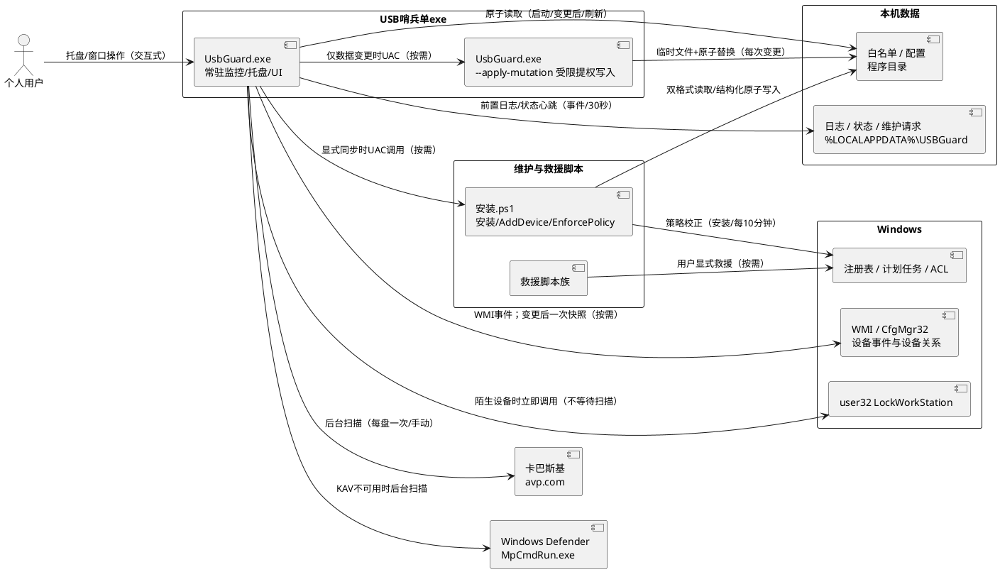
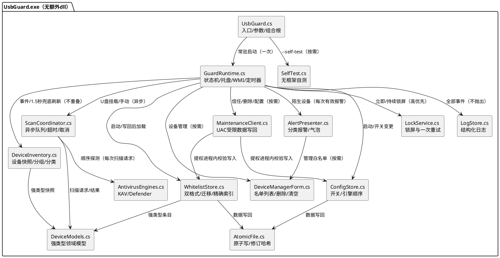
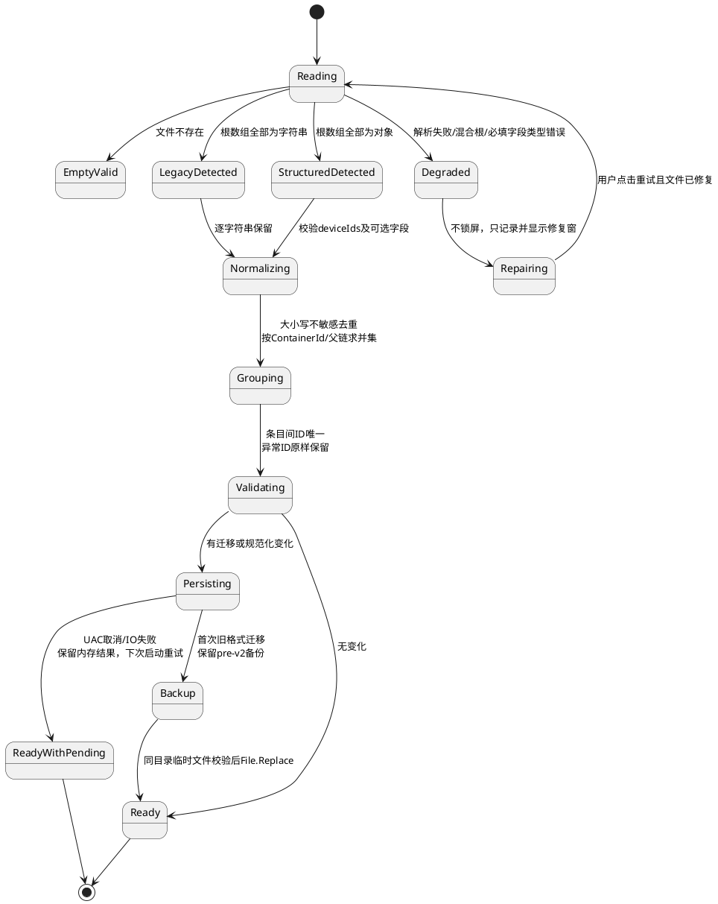
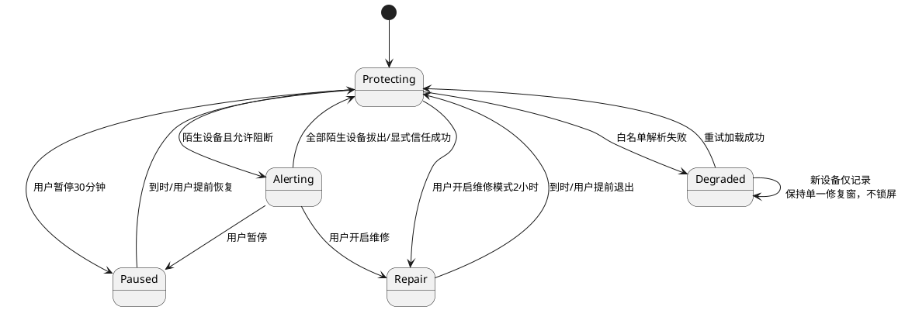
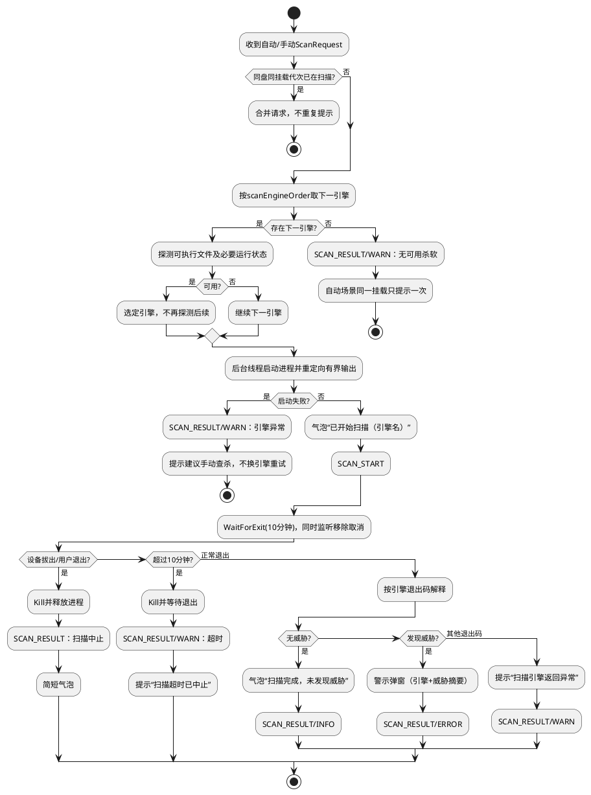
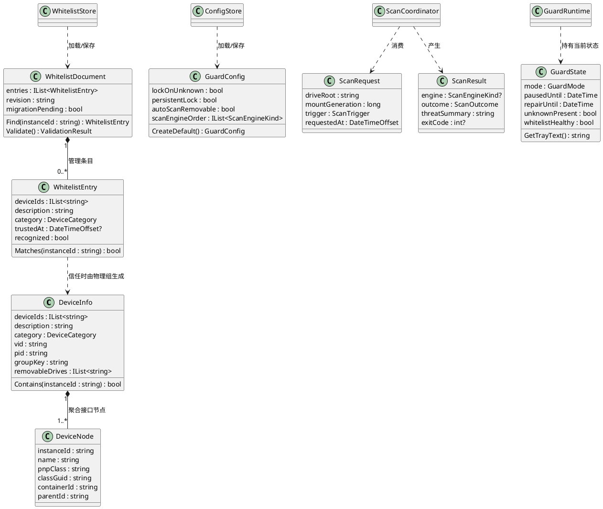

# USB哨兵完善迭代技术设计（usb_sentinel_v2）

> 需求基线：`.codeartsdoer/specs/usb_sentinel_v2/spec.md`（565 行，能力模块 5.1～5.8）。  
> 代码基线：`<项目根目录>`，主程序源码为 `程序文件\源码\UsbGuard.cs`（722 行）。  
> 技术边界：Windows 10/11、.NET Framework 4、C# 5、WinForms、仅框架程序集、无第三方依赖、不联网、中文界面，最终仍发布为单个 `UsbGuard.exe`。  
> 本文中的行号均指上述代码基线；新增文件统一放在 `程序文件\源码`，除非另有说明。

# 一、需求与存量功能关系分析

本章以实际源码而非分发包名称为准。分析结论是：本轮回填的是现有轻量托盘应用，不需要重写监控框架；但白名单、设备枚举、扫描和写入边界需要按模块拆开，否则在单文件中继续叠加会使兼容规则与 UI 线程安全问题难以验证。

## 1.1 需求功能与存量功能对比

### 1.1.1 已实现功能

| 需求功能 | 存量功能 | 代码位置 | 匹配度 |
|---|---|---|---|
| WMI 监控 USB 插拔并形成设备快照 | `ManagementEventWatcher` 监听 `Win32_DeviceChangeEvent`，通过 `Snapshot()` 求新增实例 | `UsbGuard.cs:170-209、228-240、304-328` | 75% |
| 陌生设备气泡、弹窗、立即/持续锁屏 | 气泡与立即锁屏在事件回调中执行，1.5 秒定时器补充弹窗和持续锁屏 | `UsbGuard.cs:304-328、479-510、528-620` | 75% |
| U 盘接入气泡（含盘符） | `RemovableDrives()` 查询 `DriveType=2`，`CheckRemovable()` 对新盘符提示 | `UsbGuard.cs:622-648` | 100% |
| 暂停守卫 30 分钟、维修模式 | `pausedUntil`、`pausedForever` 控制只记录不阻断 | `UsbGuard.cs:304-316、408-415、427-432` | 75% |
| 三类防护开关持久化与托盘菜单 | 三个布尔配置、菜单切换、开关状态重启后读取 | `UsbGuard.cs:348-368、417-477` | 75% |
| 托盘蓝/红图标与图标自愈 | GDI 动态绘制蓝色/红色 U，30 秒重建 `NotifyIcon` | `UsbGuard.cs:197-206、682-721` | 100% |
| 手动扫描入口与卡巴斯基异步进程调用 | 托盘枚举当前 U 盘，`avp.com SCAN ... /i0` 后台执行 | `UsbGuard.cs:450-455、650-680` | 75% |
| 日志最新在前、超限截断、记事本查看 | 每次新记录前置，约 300000 字符截断，托盘打开日志 | `UsbGuard.cs:211-226、404-406` | 75% |
| 看护与冗余状态提示 | `watchdog.vbs` 每 5 分钟由任务拉起；状态脚本尝试自愈并通知 | `安装.ps1:225-290`；`watchdog.vbs:8-39`；`状态提示.ps1:56-145` | 100% |
| 安装期策略、ACL、指纹、四任务 | 写设备限制、可移动磁盘禁执行、Users 只读 ACL、SHA256 和四个计划任务 | `安装.ps1:129-148、159-296` | 100% |
| 显式系统策略同步入口 | 托盘经 UAC 启动 `--sync-allow`，当前只补两类 `DenyDeviceClasses` | `UsbGuard.cs:59-143、457-459` | 50% |
| 旧型号级名单向实例级名单迁移 | `MigrateWhitelist()` 将不含反斜杠的型号条目映射到当前实例 | `UsbGuard.cs:253-279` | 50% |

### 1.1.2 需要扩展的功能

| 需求功能 | 存量功能 | 差异说明 | 扩展方向 |
|---|---|---|---|
| 实例 ID 精确匹配 | `NormId()` 仅接受 `USB\VID_`，并移除 `&MI_xx`；`Snapshot()` 只保留其返回值 | 会忽略 HID/USBSTOR 等关联节点，且“去 MI”不符合原实例 ID 精确匹配；现有文件实际还含 HID、ACPI 条目 | 新 `DeviceInventory` 保留完整实例 ID，只用大小写不敏感索引比较；型号/父节点信息仅用于展示和分组，不再参与命中 |
| 分类报警（U盘/HID/其他） | 当前仅显示 `FriendlyOf()` 名称和 ID | 无分类模型、分类文案和复合设备聚合 | 新增 `DeviceCategory`、`DeviceInfo`、`DeviceClassifier`；分类只影响文案、扫描和日志，不改变陌生判定 |
| 10 秒事件去重 | `alertedAt` 使用 15 秒，且 WMI 回调直接操作 UI | 时间窗不一致；复合接口可能重复报警；跨线程访问 WinForms 不可靠 | 改为实例级与物理组双重 10 秒抑制，WMI/扫描回调统一封送 UI 线程 |
| 白名单异常安全降级 | `LoadWhite()` 捕获所有异常后静默保留空集合 | 损坏会被当成空名单，随后可能误锁键鼠 | 加载结果显式区分正常、已迁移、损坏；损坏时禁止锁屏、保留文件、显示单一修复窗口并记 ERROR |
| 结构化白名单与原子写回 | `LoadWhite()/SaveWhite()` 仅读写字符串数组，`WriteAllText` 直接覆盖 | 无描述、分类、信任时间、分组；写入中断可损坏文件，且失败被静默吞掉 | 新 `WhitelistStore` 支持双格式读取、幂等迁移、备份、同目录临时文件、`File.Replace`、写后校验和错误结果 |
| 同物理设备归组 | 当前信任时逐实例加入 `HashSet`，旧迁移按型号映射 | 不能将父设备、MI 接口、HID 子节点稳定归成一项 | 以 Windows `ContainerId` 为主、CfgMgr32 父链为备，建立物理组；无法证明同组时宁可不合并，也不能丢 ID |
| 信任当前设备 | `TrustCurrent()` 将快照中所有未信任实例一次性加入，报警按钮也调用它 | 报警弹窗会扩大信任到无关设备；保存失败仍提示成功；随后自动请求策略同步 | 报警按钮改为仅信任当前物理组；托盘保留“信任当前所有已插设备”；写回成功后才更新内存和提示，策略同步只走显式入口/策略守护 |
| 多杀软扫描 | `AvpPath()/StartAvScan()` 只探测卡巴斯基，结果仅写日志 | 无 Defender、引擎顺序、无杀软提示、超时、拔出取消、威胁分类 | 抽象 `IAntivirusEngine`，实现卡巴斯基与 Defender；`ScanCoordinator` 负责后台队列、进程生命周期、结果反馈和去重 |
| 扫描配置 | 只有 `autoScanRemovable` | 缺少 `scanEngineOrder`；配置损坏不重建，保存非原子 | 新 `GuardConfig` 与 `ConfigStore`，默认卡巴斯基优先，严格校验排列，未知字段忽略，损坏时默认值重建 |
| 结构化日志 | 自由文本日志 | 缺固定级别、事件枚举、设备摘要和结果字段；按字符而非字节截断 | `LogStore.Write()` 统一入口，管道分隔并转义；300KB 按 UTF-8 字节保留最新完整行 |
| 锁屏失败处理 | `LockWorkStation()` 返回值未检查，异常被空捕获 | 无法确认失败、无一次重试和 ERROR 日志 | `LockService.TryLockWithRetry()` 检查布尔返回值，记录 Win32 错误，失败保留报警窗 |
| 托盘状态悬停与维修模式时长 | 菜单只有“守卫中/已暂停/维修模式”；维修模式可无限期 | 无 `NotifyIcon.Text` 状态；不满足禁止永久维修模式 | 集中状态机，显示防护中/暂停剩余/维修剩余/白名单异常；维修模式明确为 2 小时并可提前退出 |
| 系统允许清单同源 | `Read-White()` 对对象调用 `ToString()`；`Sync-AllowList()` 保留现有值并加入全部当前设备 | 新格式会被错误展开；删除的 USB/HID 设备可能因“当前设备兜底”再次进入 AllowDeviceIDs | PowerShell 增加结构化读取适配器；非受管设备保留安全兜底，受管 USB/HID 允许项只由白名单重建，并检测多余项 |
| 添加新设备后恢复策略 | `2-添加新设备.bat` 只删除 DenyDeviceClasses，结束调用只补类规则的 `--sync-allow` | 未完整临时解锁，也未把新实例同步到 AllowDeviceIDs | 结束改调 `安装.ps1 -EnforcePolicy`；主程序 `--sync-allow` 也转为该脚本的兼容包装，消除两套注册表写入逻辑 |
| 使用说明与救援一致性 | 说明仍描述旧名单、仅卡巴斯基和旧卸载流程；救援脚本对注册表路径/无目标处理不一致 | 文档与实际功能漂移，误锁后的下一步不够明确 | 更新说明版本、日期、配置与救援清单；修复救援脚本目标检测及 AllowDeviceIDs 子键值写法 |

### 1.1.3 需要新增的功能或接口

**A. 设备领域模型与分类服务**

- 输入：WMI PnP 节点、CfgMgr32 设备关系、可移动磁盘/分区关联。
- 输出：`DeviceInfo`（物理设备）、`RemovableVolume`（盘符与存储关系）、`DeviceCategory`。
- 核心逻辑：完整实例 ID 规范化、物理分组、VID/PID 提取、storage > hid > other 的展示分类优先级。
- 依赖：仅 `System.Management`、Windows `cfgmgr32.dll`，不新增包。

**B. 白名单仓储与迁移服务**

- 输入：旧字符串数组或新对象数组、当前/历史设备关系、结构化变更请求。
- 输出：强类型条目集合、精确匹配索引、迁移/错误结果、原子写回结果。
- 核心逻辑：双格式识别、同组并集、重复 ID 合并、异常 ID 原样保留、旧文件备份、幂等重试。
- 依赖：设备模型、原子文件组件、结构化日志、特权写回组件。

**C. 设备管理窗口**

- 输入：已加载白名单快照与用户删除/清空指令。
- 输出：列表展示、单条删除、带文字确认的 P2 清空、保存失败/并发冲突反馈。
- 核心逻辑：单实例窗口、单选 ListView、二次确认、修订号防丢失更新、写成功后刷新。
- 依赖：白名单仓储、维护写回客户端、日志；不依赖网络和设备在线状态。

**D. 多杀软扫描子系统**

- 输入：盘符、挂载代次、自动/手动来源、引擎顺序。
- 输出：探测结果、开始/完成/威胁/异常/超时/取消事件及日志。
- 核心逻辑：顺序选择第一个可用引擎，后台执行整盘扫描，10 分钟超时，拔出取消，同盘在位去重。
- 依赖：卡巴斯基/Defender 引擎、托盘通知、日志；锁屏服务不得等待该模块。

**E. 受保护数据维护写回接口**

- 输入：当前用户目录中的强类型变更请求、期望文件修订哈希。
- 输出：成功、权限取消、校验失败、冲突或 IO 错误。
- 核心逻辑：同 exe 以 `--apply-mutation` 提权执行有限操作，重新读取并校验后原子写入，主进程随后重载。
- 依赖：现有 ACL、UAC、白名单/配置仓储。该接口只写固定两个 JSON，不接受任意路径或任意注册表操作。

**F. 自测与诊断入口**

- 输入：扩展后的 `--test-prompt`、`--test-scan-probe`、`--test-devices`、`--self-test` 等参数。
- 输出：分类弹窗、引擎探测结果、只读管理窗口、纯函数/临时目录测试退出码。
- 核心逻辑：保留旧测试参数行为，新增测试均不联网、不自动信任设备；真实锁屏和真实扫描在说明中明确标注。

## 1.2 存量功能详细分析

### 1.2.1 主循环、接口契约与线程边界

- `Main()`（49-57）是无类型参数的静态入口，目前通过全参数数组查找三个开关。扩展时保留旧参数，新增统一 `CommandLineOptions` 解析，非法参数应给出中文用法而非进入常驻监控。
- `RunGuard()`（170-209）完成单实例互斥、配置/名单加载、托盘、WMI 和两个 WinForms Timer。互斥名包含程序目录哈希，应保留，避免不同目录副本互相抢进程。
- `OnDeviceEvent()`（304-328）运行在 WMI 回调线程，却直接访问 `NotifyIcon`、集合和锁屏；新设计必须让回调只触发异步刷新，最终 UI 与共享状态都在 UI 线程处理。
- `CheckPersistent()`（498-510）每 1.5 秒重新执行 WMI 全量查询。新设计保留 1.5 秒防护节拍，但快照查询改为不可重入的后台刷新，UI 使用最近完成快照，避免定时器重入和界面卡顿。
- 托盘菜单在每次 `Opening` 时重建（417-477），适合继续作为状态展示边界；新增菜单不改为永久常驻窗口，保持轻量定位。

### 1.2.2 白名单与设备身份的约束

- `LoadWhite()`（330-337）把所有对象转为大写字符串；它既无法识别对象条目，也没有“加载失败”返回值。`SaveWhite()`（339-346）排序后覆盖原文件且无结果，调用方无法诚实反馈保存状态。
- `NormId()`（242-251）是现有匹配语义的核心约束：它过滤非 `USB\VID_`，并剥离 MI。新实现不能简单把现有 `white` 改成对象列表而继续复用此函数，否则分类和分组完成后仍会误报。
- 当前实际 `usb-whitelist.json` 已包含 USB 父设备、MI 接口、HID 子集合及非 USB 条目。迁移必须逐 ID 保留，不能假定输入只有 `USB\VID_`，也不能只保存当前在线设备。
- `FriendlyOf()`（281-302）对每个 ID 再执行一次全量 WMI 查询；设备风暴时会放大延迟。新快照一次性携带名称、类和容器信息，展示层只读缓存。
- 旧 `MigrateWhitelist()`（267-279）解决的是更早的“型号级”数据，不等同本轮“字符串实例数组→对象条目数组”。本轮保留对无反斜杠旧值的无损保留，但禁止继续按型号自动放行，以免扩大信任面。

### 1.2.3 锁屏、报警与日志的约束

- `ShowAlertForm()`（541-620）已经形成固定对话框、微软雅黑、白底、顶部警示文本和底部按钮的风格，设备管理窗口及新增分类报警应复用这一视觉语言。
- 非测试弹窗关闭或 25 秒倒计时结束会再次锁屏，持续锁屏不是单纯的 1.5 秒轮询；改造时保留这些安全行为，同时把锁屏调用集中到可记录结果的服务。
- `IsWorkstationLocked()`（479-490）避免锁屏界面重复弹窗，继续作为报警展示前置条件，但不能用它抑制必要的首次锁屏。
- `Log()`（211-226）永远吞掉 IO 异常，符合“日志故障不影响防护”；新结构化实现也必须保持无抛出契约。日志路径应统一为 `%LOCALAPPDATA%\USBGuard\usb-guard.log`，不再依赖程序目录写权限。

### 1.2.4 扫描模块的约束

- `AvpPath()`（650-662）只搜索两个 Kaspersky Lab 根目录的直接子目录，可作为卡巴斯基提供器基线；路径存在即候选，进程启动失败属于扫描异常，不再换引擎重试。
- `StartAvScan()`（664-680）已使用 `EnableRaisingEvents`，证明可以不阻塞 UI；但没有重定向输出、没有超时控制，也未处理盘符移除和进程资源释放。
- `CheckRemovable()`（634-648）只知道新增盘符，不知道对应物理设备。新模型需把盘符与容器/设备组关联，才能对同一 U 盘只提示一次并在拔出时取消正确进程。
- 自动扫描和手动扫描必须共用协调器，但手动入口忽略 `autoScanRemovable`；锁屏路径只提交扫描请求，不等待探测、进程启动或结果。

### 1.2.5 安装、策略守护与 ACL 的约束

- `安装.ps1` 的 `Read-White()`（44-50）、`Save-White()`（52-56）是 C# 之外的关键兼容面。所有现有调用方最终需要的是扁平 ID 列表，因此保留 `Read-White` 的扁平输出最稳妥，另增结构化入口供编辑使用。
- `Sync-AllowList()`（101-127）当前采用“保留安全旧值 + 所有当前设备 + 白名单”的并集，适合防误伤但不支持删除收敛。新算法必须区分受管 USB/HID 与非受管设备：前者由名单精确重建，后者继续保留本机/Tailscale 等安全兜底。
- `Invoke-Enforce()`（320-346）只检查缺失项和危险项，不检查已删除的白名单 ID 是否仍残留，也不完整校验 Deny_Execute/DenyDeviceClasses；本轮需改为比较期望集合与实际集合。
- `Set-ProtectedAcl()`（129-148）令程序目录 Users 只读，而实时任务以 Limited 身份运行（278-286）。因此普通主进程不能可靠直接保存白名单和配置。设计采用同 exe 的受限提权维护入口，不通过放开整个目录 ACL 来规避问题。
- 主程序 `ApplyAllowList()`（90-108）与安装脚本都能写策略，但能力不对等。为保持单一策略来源，新版 C# 不再直接写注册表，`--sync-allow` 仅作为旧批处理兼容入口转调安装脚本。
- `integrity.json` 当前覆盖 exe、看护和安装脚本。部署时必须在 exe 与脚本最终落盘后重算；白名单、配置和日志属于可变数据，不纳入指纹。

### 1.2.6 基线差距与设计决策摘要

1. 采用**多源文件、单 exe 输出**，而不是继续扩大 722 行静态类，也不引入 DI、JSON、日志等第三方库。
2. 采用**完整实例 ID 精确命中 + ContainerId 物理归组**，归组只改变条目组织和信任操作，不把型号级匹配重新引入防护。
3. 采用**双格式读取、对象数组单格式写出**，PowerShell 与 C# 使用相同字段、大小写和原子替换约定。
4. 采用**扫描与报警完全解耦**，扫描工作线程永不进入锁屏关键路径。
5. 采用**主进程负责监控、提权维护入口负责受保护 JSON、安装/策略脚本负责注册表**的权限分工。
6. 采用**显式损坏状态而非空名单降级**，优先避免误锁键鼠；任何迁移失败都保留原文件和备份。
# 二、增量设计方案

## 2.1 实现模型

### 2.1.1 上下文视图



**上下文约束：**

- 主程序没有网络客户端、HTTP、Socket、WMI 远程连接或遥测接口；所有 WMI 均为本机 `root\cimv2`。
- 注册表策略只由安装/维护/救援脚本写入。常驻进程只读取策略状态，显式“同步系统 USB 锁定”也是启动脚本，不直接改注册表。
- 杀软扫描进程与主进程分离；扫描结果通过进程退出和受限输出返回，不引入服务、命名管道或网络 RPC。
- 看护任务、策略守护、状态提示、实时进程四个计划任务保持现有名称与触发频率。

### 2.1.2 服务/组件总体架构

**演进决策：拆分为多个 C# 源文件，但继续编译成一个零依赖 exe。** 不继续扩充单文件的原因是设备关系、迁移、扫描进程和窗口各有独立异常边界；拆文件可让纯逻辑自测不启动托盘。无需拆分 dll，也不改变看护、任务和完整性校验只识别 `UsbGuard.exe` 的部署模型。



**源文件职责与存量衔接：**

| 文件 | 职责 | 与现有代码的衔接 |
|---|---|---|
| `UsbGuard.cs`（修改） | `Main`、命令行解析、全局异常、组合根、提权维护入口 | 保留 49-57 的三个旧参数；`RunGuard` 的启动顺序迁移到 `GuardRuntime` |
| `GuardRuntime.cs`（新增） | 单实例运行上下文、状态机、WMI 刷新、托盘、暂停/维修、持续锁屏协调 | 承接 170-209、304-328、370-381、417-510、622-648；不再让 WMI 回调直接碰 UI |
| `DeviceModels.cs`（新增） | 枚举和设备、白名单、配置、扫描、日志、维护请求 DTO | 替代散落的静态布尔、字符串字典和无结果返回值 |
| `DeviceInventory.cs`（新增） | PnP 快照、ContainerId/父链、物理分组、分类、盘符关联 | 替代 228-302、492-496、622-632；`ModelOf` 仅保留为 VID/PID 展示辅助 |
| `WhitelistStore.cs`（新增） | 双格式加载、幂等迁移、索引、变更、写后校验 | 替代 267-279、330-346；所有实例 ID 使用 `StringComparer.OrdinalIgnoreCase` |
| `ConfigStore.cs`（新增） | 默认值、字段校验、引擎顺序、损坏重建 | 替代 348-368；旧三字段配置无需手工升级 |
| `AtomicFile.cs`（新增） | 同目录临时文件、刷盘、`File.Replace`/首次 `Move`、SHA256 修订号 | 供白名单、配置、迁移备份和请求文件共用；不向未知路径写 |
| `MaintenanceClient.cs`（新增） | 判断写权限、创建变更请求、UAC、等待结果、冲突处理 | 修复 Limited 实时任务与只读 ACL 的冲突；替代 `SaveWhite` 静默失败和 `TrustCurrent` 假成功 |
| `AlertPresenter.cs`（新增） | 分类文案、报警窗、气泡、白名单异常修复窗 | 重构 512-620；保留现有按钮风格、倒计时与非测试关闭即锁屏 |
| `DeviceManagerForm.cs`（新增） | 白名单 ListView、详情、单删、P2 清空、空态 | 新增托盘和报警窗入口；不执行设备枚举，保证 1 秒内呈现 |
| `AntivirusEngines.cs`（新增） | 引擎探测、命令行、退出码和威胁摘要解释 | 卡巴斯基路径逻辑承接 650-662；新增 Defender 提供器 |
| `ScanCoordinator.cs`（新增） | 后台顺序扫描、单盘去重、输出上限、10 分钟超时、移除取消 | 替代 664-680；通过事件通知 `GuardRuntime`，不直接锁屏 |
| `LockService.cs`（新增） | `LockWorkStation` 返回值检查、一次重试、错误日志 | 替代 323、573、602、612 等散落的空调用 |
| `LogStore.cs`（新增） | 固定事件枚举、级别、摘要、转义、300KB 截断 | 替代 211-226；保留 `LogErr` 作为最后的 `guard-error.log` 兜底 |
| `SelfTest.cs`（新增） | 无第三方测试框架的纯逻辑与临时文件自测 | 由 `--self-test` 调用，不进入托盘、不执行真实锁屏/扫描 |
| `编译.bat`（新增） | 明确 `/langversion:5`、引用程序集和全部源文件，生成暂存 exe | 输出 `UsbGuard.next.exe`，不直接覆盖正在运行的程序 |

**配置策略：** 仍使用单一 `usb-guard-config.json`，不引入注册表用户配置或第二份配置。三个旧开关和 `scanEngineOrder` 缺省值均由 `GuardConfig.CreateDefault()` 统一提供；暂停和维修剩余时间属于会话状态，不持久化，以防异常重启后长期失去防护。

### 2.1.3 实现设计文档

#### A. 启动、事件和 UI 线程模型

```plantuml
@startuml
start
:解析命令行并建立路径;
:LoadCfg（损坏则默认值运行并请求原子重建）;
:LoadWhite（双格式读取）;
if (JSON损坏/不可读?) then (是)
  :状态=白名单异常;
  :禁止一切自动锁屏;
  :保留原文件，显示单一修复窗;
else (否)
  if (旧格式或重复/可合并?) then (是)
    :内存中幂等迁移并建立精确索引;
    :自动请求受限提权持久化;
  else (否)
    :直接建立精确索引;
  endif
endif
:创建UI SynchronizationContext、托盘和菜单;
:后台获取首次设备快照;
:启动WMI watcher与1.5秒/30秒定时器;
while 运行期间 is (有WMI事件)
  :WMI线程只投递刷新请求;
  :UI线程300ms合并事件;
  :ThreadPool执行一次非重入快照;
  :结果Post回UI线程;
  :先处理陌生报警与锁屏;
  :后提交U盘异步扫描;
endwhile
:退出时停止watcher、取消扫描、释放图标;
stop
@enduml
```

- 快照刷新用 `Interlocked.Exchange` 保证同一时刻最多一个在途查询；1.5 秒节拍到来时若上次未完成，不并发叠加 WMI 查询。
- 事件合并窗口固定为 **300ms**，随后立即查询，不额外等待固定秒数。正常情况下事件到气泡/弹窗/首次锁屏总预算为：合并 300ms + 快照/分类 1.5s + UI 100ms，留出约 1.1s 余量满足 3 秒要求。
- UI 线程不等待 WMI、杀软、UAC 或文件 IO 长时间操作。设备管理窗口读取已加载快照；刷新文件采用短时后台读取后回 UI。
- 陌生设备处理顺序固定为：记录 `DEVICE_INSERT` → 气泡/弹窗 → 按开关立即锁屏 → 提交扫描。任何扫描异常都不能反向阻断前三步。

#### B. 设备身份、物理分组与分类

1. **精确身份：** `NormalizeInstanceId` 只做去空白、统一反斜杠边界和大小写规范化，不移除 `&MI_xx`、`&COL_xx`，不把父 ID 与子 ID 互换。匹配字典比较器为 `OrdinalIgnoreCase`。
2. **监控范围：** 保留 DeviceID 以 `USB\`、`USBSTOR\` 起始的节点，以及通过父链/ContainerId 归属于 USB 物理设备的 HID 子节点。纯蓝牙 HID、ACPI 等内置设备不因为新快照而被当作陌生 USB；它们在旧名单中仍无损保留。
3. **物理组主键：** 优先通过 CfgMgr32 读取 `DEVPKEY_Device_ContainerId`，同一非空 GUID 的 USB 父节点、MI 接口和 HID 子集合归为一个 `DeviceInfo`。查询离线旧条目时使用 `CM_LOCATE_DEVNODE_PHANTOM`，尽量覆盖已安装但当前未插入的设备。
4. **父链后备：** ContainerId 缺失时，使用 `CM_Locate_DevNodeW`、`CM_Get_Parent`、`CM_Get_Device_ID` 向上找到不带 MI 的 `USB\VID_xxxx&PID_xxxx\<实例>` 作为组键。所有 P/Invoke 使用显式字符集、定长缓冲和返回值检查，不使用不安全转换。
5. **不猜测合并：** 对无容器、无父链或格式异常的 ID，使用 `UNGROUPED:<完整原值>` 独立成组并记 WARN。该规则优先满足“不丢 ID、不错误合并”；设备下次在线并信任时再通过真实设备关系合并。
6. **分类：** 通过 `Win32_DiskDrive` → 分区 → `Win32_LogicalDisk` 关联 `DriveType=2` 的节点判为 `storage`；无存储卷时，`PNPClass=HIDClass`、HID ClassGuid 或 USB 容器内 HID 子节点判为 `hid`；其余为 `other`。复合设备展示优先级为 storage > hid > other，但详细摘要仍列出 HID 等接口。
7. **VID/PID：** 仅从完整 ID 中用固定四 hex 规则提取，供表格展示；解析失败显示 `—`，不影响白名单命中。
8. **信任命中：** 每个在线节点仍按完整 ID 精确命中。物理组的作用是把一次显式信任覆盖到当时可发现的全部接口、把管理窗口聚成一行，不是“同型号自动放行”。

#### C. 白名单迁移状态机与幂等规则



- 幂等依据是内容而非“是否已写过”标志：对象数组再次加载时，相同 ID 集合同组、排序和字段默认值产生相同输出；无变化不写文件。
- 同组多个旧条目合并时，`deviceIds` 取并集；描述取首个非空且优先当前系统名称；分类取 storage > hid > other；`trustedAt` 取最早有效时间，无则缺省。重复实例 ID 只保留一次。
- 无反斜杠的旧型号值、无法解析的实例字符串都放入“未识别条目”并原样保留，不参与型号匹配。正常实例 ID 可统一为大写；异常值不改写。
- 迁移先在同目录生成并回读校验临时文件，再以 `File.Replace` 替换；旧格式首次迁移备份为 `usb-whitelist.pre-v2.bak`，已有备份不覆盖。任何失败均不删除原文件。
- 迁移写回失败不等于数据解析失败：本次进程仍使用内存中的完整精确 ID 集合，避免误报；管理窗口显示“迁移尚未保存”，下次启动自动重试。

#### D. 锁屏与守卫状态机



- `Protecting`、`Paused`、`Repair`、`Degraded` 与是否存在陌生设备分开记录，避免 `blockedNow` 一个布尔表达全部状态。
- 暂停和维修期间仍接收并记录设备事件，但不弹陌生报警、不自动扫描、不锁屏；恢复后立即用最新快照重新判定，不依赖下一次插拔。
- 维修模式由现有无限 `pausedForever` 改为明确的 **2 小时** 上限，菜单直接显示“维修模式（最长 2 小时）”；这是为满足“禁止永久生效”所作的产品化选择，用户可随时提前退出。
- `LockService` 检查 `LockWorkStation()` 布尔返回值；失败时记录 Win32 错误并重试一次，仍失败记 ERROR 且保留/重建报警窗。UI 不用 `Thread.Sleep` 等待重试。
- 持续锁屏仍按 1.5 秒防护节拍判断，但已处于锁屏界面时不重复弹窗。陌生设备全部移除后，关闭报警窗、图标恢复蓝色并记录 `GUARD_STATE`。
- 托盘 `NotifyIcon.Text` 每次状态变化及剩余分钟变化时更新，限制在系统允许长度内：防护中 / 暂停守卫（剩 N 分钟）/ 维修模式（剩 N 分钟）/ 白名单异常（不锁屏）。
- 用户已主动点击信任/保存后，等待 UAC 的短暂期间仅抑制重复持续锁屏，监控和首次报警仍运行；维护完成、取消或超时立即恢复，且未写成功绝不视为已信任。

#### E. 多杀软扫描活动图



- 同一时间只运行一个扫描工作线程，请求按盘符队列处理；避免多盘同时启动杀软造成内存/CPU 峰值。单个进程标准输出与错误输出各只保留末尾 32 行、总计最多 8KB，防止长扫描撑高内存。
- 盘符键包含挂载代次，拔出先取消旧任务，再允许新插入的同盘符启动新任务。自动“无杀软”提示也按挂载代次去重；用户每次显式点击手动扫描可再次看到结果。
- 扫描引擎一旦被选定，启动失败、异常退出或超时均不自动换另一个引擎，避免对同一盘重复长时间扫描，符合 5.3.3。
- 扫描只传本地盘符根目录，不带在线查杀、云查询或病毒库更新参数。查杀是否联网由杀软自身策略决定，USB哨兵自身不发起任何网络操作，也不调用更新命令。

#### F. 受保护 JSON 写回与并发控制

1. 有写权限的管理员/维护进程直接通过仓储保存；Limited 主进程通过 `MaintenanceClient` 发起 UAC。请求只允许 `Migrate`、`TrustGroup`、`TrustAll`、`RemoveEntry`、`ClearEntries`、`SaveConfig` 六种操作。
2. 请求写入 `%LOCALAPPDATA%\USBGuard\maintenance\<随机GUID>.request.json`，包含请求 ID、操作、强类型载荷和期望修订 SHA256；结果写入对应 `.result.json`。路径由程序生成，提权入口校验其必须位于该固定目录。
3. 同 exe 以 `--apply-mutation <请求路径>` 提权运行。它重新加载当前文件、校验操作和修订、重新枚举信任组（Trust 操作）、在命名互斥体中执行读改写，并原子落盘；不得接受调用方指定目标文件。
4. C# 与 PowerShell 的读改写使用同名 `Global\UsbGuardWhitelist_<目录哈希>` 互斥体。策略脚本只读时可等待原子替换后的完整文件；凡涉及修改名单的 `Invoke-AddDevice` 也必须进入互斥体。
5. 主进程收到成功结果后重新加载文件并重建索引，再更新列表/内存开关和提示。UAC 取消、预期修订冲突、校验失败或 IO 失败均保持原内存与原文件，显示“保存失败，名单未变更”或“名单已变化，请刷新后重试”。
6. 文件锁只覆盖短时的名单/配置写回，不覆盖杀软扫描和 WMI 查询。维护请求、结果均设置当前用户目录 ACL，不写设备之外的敏感信息，完成后删除临时请求，失败时保留最近一份用于诊断。

#### G. 系统策略同源与救援恢复

- 安装时先显式信任当前已插 USB/HID 物理组并合并既有名单，再重建系统允许列表，确保升级时当前键鼠不会因新算法被移出。
- `Sync-AllowList` 的期望集合改为：**现有及当前非受管 PnP ID 安全兜底 + 结构化白名单展开的合法受管 USB/HID 实例 ID**。受管范围至少包括 `USB\VID_*`、`USBSTOR\*`、USB 容器内 `HID\*`；网卡、PCI、ACPI、Tailscale 等非受管设备继续保留。
- 对受管 ID 不再保留“当前在线但未信任”的旧注册表值，因此设备管理窗口删除后，下次显式同步或 10 分钟策略守护会将其从 AllowDeviceIDs 移除。不得通过把当前所有设备重新并入而破坏删除语义。
- `Invoke-Enforce` 同时比较多余项、缺失项、危险项、DenyUnspecified、DenyDeviceClasses 和 Deny_Execute；仅在存在漂移时写入，并写 Windows 事件日志。
- `TrustCurrent` 不再自动调用策略同步。信任/删除成功后提示“系统驱动策略将在下次策略守护或手动同步时更新”，满足主程序无显式同步不得写策略的边界。
- `ElevateSyncAllow` 不再只凭 DenyDeviceClasses 是否存在来判断“未安装”：只要 DenyUnspecified、AllowDeviceIDs 或既有安装任务表明已完成过安装，显式同步就必须继续执行，避免类规则恰好漂移时拒绝修复；完全未安装时才保留运行安装脚本的引导。
- `2-添加新设备.bat` 的临时解锁与恢复必须成对：解锁 DenyUnspecified 和类限制，用户显式信任后调用 `安装.ps1 -EnforcePolicy` 恢复；若窗口异常关闭，策略守护仍在 10 分钟内恢复。
- 救援脚本先查找目标输入设备；无目标时输出“目标设备未找到，请改用 2-添加新设备.bat”，不以成功口吻结束。`allow-mouse.ps1` 对 `AllowDeviceIDs` 使用与安装脚本一致的“子键下编号字符串值”结构，而不是同名注册表属性。

## 2.2 接口设计

### 2.2.1 总体设计

所有 C# 接口均为 exe 内部契约，不公开为 COM、IPC 或网络 API。数据 DTO 使用具体类、泛型集合和枚举；JSON 边界仅由仓储负责把 `JavaScriptSerializer` 的松散对象转换为强类型模型，业务层不得传递 `Dictionary<string, object>` 代替领域对象。

| 接口/入口 | 分类 | 主要调用方 | 稳定性 | 变更策略 |
|---|---|---|---|---|
| `IDeviceInventory` | 设备查询 | `GuardRuntime`、迁移、信任 | 内部稳定 | 可扩展快照字段，不改变完整 ID 命中语义 |
| `WhitelistStore` | 数据仓储 | 主进程、提权维护、自测 | 内部稳定 | 新字段必须可选；旧字符串数组始终可读 |
| `ConfigStore` | 数据仓储 | 主进程、提权维护 | 内部稳定 | 新字段必须缺省兼容，未知字段忽略 |
| `ILogStore` | 诊断 | 全模块 | 内部稳定 | 只能追加固定事件枚举，调用不得抛出 |
| `IAntivirusEngine` | 扩展点 | `ScanCoordinator` | 内部实验 | 新引擎实现探测/命令/结果解释，不改协调器 |
| `ScanCoordinator` | 扫描协调 | `GuardRuntime`、自测 | 内部稳定 | 只扩展事件数据，不允许同步等待进入 UI |
| `AlertPresenter` / `DeviceManagerForm` | UI | `GuardRuntime` | 内部实验 | 可调整布局，保持中文文案和确认规则 |
| `MaintenanceClient` | 权限边界 | 托盘、窗口、迁移 | 内部稳定 | 仅新增白名单操作枚举，禁止任意路径写入 |
| `LockService` | 系统适配 | `GuardRuntime`、报警窗 | 内部稳定 | 锁屏重试策略集中修改 |
| `--test-*` / `--self-test` | 命令行 | 用户/部署验证 | 稳定 | 旧参数保留；新测试不得隐式改真实名单 |
| `--apply-mutation` | 命令行维护 | 仅 `MaintenanceClient` | 内部稳定 | 请求带操作校验和修订，不对用户承诺通用接口 |
| `--sync-allow` | 命令行维护 | 旧批处理/托盘 | 稳定兼容 | 保留名称，实现转为安装脚本包装 |
| PowerShell `Read-White` | 脚本兼容 | 安装/添加/策略守护 | 稳定 | 永远输出扁平、去重、大写 ID 数组 |
| PowerShell `Read-WhiteEntries` / `Save-WhiteEntries` | 脚本数据接口 | 安装/添加设备 | 新增稳定 | 字段与 C# 对象数组格式一致 |

### 2.2.2 接口清单

以下仅定义签名和契约，不规定逐行实现。所有类型默认 `internal`，属性不使用 C# 6 的 get-only 自动属性、表达式体或字符串插值。

#### A. 设备查询与分类

```csharp
internal interface IDeviceInventory
{
    DeviceSnapshot CaptureSnapshot();
    DeviceInfo BuildPhysicalGroup(string instanceId, DeviceSnapshot snapshot);
}

internal static class DeviceClassifier
{
    internal static DeviceCategory Classify(DeviceGroupEvidence evidence);
    internal static string GetDisplayName(DeviceCategory category);
    internal static string GetAdvice(DeviceCategory category);
}
```

- **业务说明：** 一次快照返回物理设备、完整节点索引和可移动卷；分类器为纯函数，便于无硬件自测。
- **前置条件：** 仅本机查询；调用方不得把 `DeviceID=null` 当作有效信任依据。
- **后置条件：** 快照不可由 UI 原地修改；每个节点最多属于一个物理组，身份读取失败生成“未知设备（身份读取失败）”候选而不崩溃。
- **异常映射：** WMI/CfgMgr32 单项失败降级为缺失属性并记 WARN；整次快照失败保留上一快照并记录 ERROR，不清空现有防护状态。
- **调用示例：** `DeviceSnapshot snapshot = inventory.CaptureSnapshot();`

#### B. 白名单与配置

```csharp
internal sealed class WhitelistStore
{
    internal WhitelistLoadResult Load(string path, DeviceSnapshot snapshot);
    internal StoreWriteResult Save(string path, WhitelistDocument document,
        string expectedRevision, bool createLegacyBackup);
    internal WhitelistDocument TrustGroup(WhitelistDocument current,
        DeviceInfo device, DateTimeOffset trustedAt);
    internal WhitelistDocument RemoveEntry(WhitelistDocument current, string entryKey);
    internal WhitelistDocument ClearEntries(WhitelistDocument current);
}

internal sealed class ConfigStore
{
    internal ConfigLoadResult Load(string path);
    internal StoreWriteResult Save(string path, GuardConfig config,
        string expectedRevision);
}
```

- **业务说明：** `Load` 不直接修改全局状态；`Save` 只有在临时文件回读校验、修订检查和原子替换全部成功后才返回成功。
- **前置条件：** `deviceIds` 至少一项；保存前条目间无重复 ID；`scanEngineOrder` 必须包含两种已知引擎各一次。
- **后置条件：** 成功时文件为 UTF-8 无 BOM、对象条目数组；失败时目标文件字节不变。配置损坏使用安全默认值并生成 WARN，不进入白名单式停锁状态。
- **异常映射：** JSON/字段错误返回 `Corrupt`；权限返回 `AccessDenied`；修订不符返回 `Conflict`；其他 IO 返回 `IoError`，均不得把异常抛入 WMI 或 UI 事件。
- **调用示例：** `WhitelistLoadResult loaded = whitelistStore.Load(path, snapshot);`

#### C. 扫描引擎与协调器

```csharp
internal interface IAntivirusEngine
{
    ScanEngineKind Kind { get; }
    string DisplayName { get; }
    EngineProbeResult Probe();
    ProcessStartInfo BuildScanCommand(string driveRoot);
    ScanOutcome InterpretResult(int exitCode, string boundedOutput);
}

internal sealed class ScanCoordinator
{
    internal event EventHandler<ScanStateEventArgs> StateChanged;
    internal ScanRequestResult RequestScan(ScanRequest request);
    internal bool CancelDrive(string driveRoot, ScanCancelReason reason);
    internal void Dispose();
}
```

- **业务说明：** `Probe` 只做本机可用性判断；`BuildScanCommand` 对盘符统一为带尾部反斜杠的根路径并正确加引号；`InterpretResult` 明确区分无威胁、威胁和异常。
- **前置条件：** 自动请求要求 `autoScanRemovable=true`，手动请求不受此限制；`driveRoot` 必须来自当前可移动卷快照或显式测试参数校验。
- **后置条件：** 请求立即返回，调用方可继续锁屏；完成/取消后释放 `Process` 并移除活动键。
- **异常映射：** 无引擎 `NoEngine`；启动失败 `StartFailed`；超时 `Timeout`；拔出 `DeviceRemoved`；退出码异常 `EngineError`。除“已选引擎启动前不可用”外，不在失败后换引擎重试。
- **调用示例：** `ScanRequestResult accepted = scanCoordinator.RequestScan(request);`

#### D. 报警、设备管理与锁屏

```csharp
internal sealed class AlertPresenter
{
    internal void ShowUnknown(IList<DeviceInfo> devices, bool testMode);
    internal void ShowWhitelistError(string message);
    internal void CloseAlert();
    internal void ShowScanResult(ScanResult result);
}

internal sealed class DeviceManagerForm : Form
{
    internal DeviceManagerForm(WhitelistDocument initialDocument,
        MaintenanceClient maintenanceClient, ILogStore logStore);
    internal void ReloadDocument(WhitelistDocument document);
}

internal sealed class LockService
{
    internal LockResult TryLockWithRetry();
}
```

- **业务说明：** 报警展示只接收分类后的设备；管理窗口不自行解析 JSON，所有变更经维护客户端；锁屏结果可判断首次和重试是否成功。
- **前置条件：** 所有 Form 方法在 UI 线程调用；管理窗口同时最多一个实例；删除和清空必须完成各自确认。
- **后置条件：** 关闭管理窗口不退出主消息循环；关闭测试弹窗退出对应测试进程；真实报警窗的关闭行为保持现有安全策略。
- **异常映射：** UI 创建失败记 ERROR 并保留气泡；维护失败不刷新列表；锁屏失败返回 `LockResult.Failed` 而不是吞异常。
- **调用示例：** `LockResult locked = lockService.TryLockWithRetry();`

#### E. 结构化日志与维护写回

```csharp
internal interface ILogStore
{
    void Write(LogLevel level, LogEventType eventType,
        DeviceSummary device, string actionResult);
}

internal sealed class MaintenanceClient
{
    internal void ApplyAsync(MutationRequest request,
        Action<MutationResult> completed);
    internal MutationResult ApplyInCurrentProcess(MutationRequest request);
}
```

- **业务说明：** 日志是所有事件的唯一写入口；维护客户端同时服务普通进程的 UAC 调用和提权进程内实际执行。
- **前置条件：** `actionResult` 不含文件内容、剪贴板或扫描文件清单；维护操作、载荷与当前用户目录有效。
- **后置条件：** 日志方法不抛出；维护回调回到 UI 线程且只执行一次。成功后调用方必须重载文件，不能仅根据请求假设落盘内容。
- **异常映射：** 日志失败静默跳过；维护结果分为 `Success`、`Cancelled`、`AccessDenied`、`Conflict`、`InvalidRequest`、`Timeout`、`IoError`。
- **调用示例：** `logStore.Write(LogLevel.Info, LogEventType.GuardState, null, "防护已启动");`
## 2.3 数据模型

### 2.3.1 设计目标

1. **与领域术语一致：** 白名单条目代表一个物理设备，`deviceIds` 是其全部已知接口实例；设备分类和信任时间属于条目，不另建平行数组。
2. **匹配效率：** 条目不超过 500 时，以扁平哈希索引完成 O(1) 平均命中；管理窗口按条目展示，匹配仍按完整实例 ID。
3. **无损兼容：** 旧字符串数组和当前混有 USB/HID/ACPI 的真实文件均可读；迁移前后有效 ID 集合保持不变，异常字符串不丢失。
4. **故障安全：** 文件损坏进入白名单异常，不把它解释为空名单；配置损坏则采用三个 true 与默认引擎顺序并重建。
5. **稳定存储：** 所有 JSON 为 UTF-8 无 BOM；写回同卷原子替换；排序稳定，避免策略守护和 UI 刷新造成无意义差异。
6. **轻量与隐私：** 不存扫描文件清单、威胁文件内容或用户文档内容；扫描输出仅用于形成有界威胁摘要，日志不记录文件路径清单。

### 2.3.2 模型实现



> 类图省略了技术性的进程 ID、临时文件名等实现字段；它们只存在于维护适配层，不进入领域对象。`GuardRuntime`、`WhitelistStore` 等依赖类在组件图中定义，此处重点展示数据关系。

#### A. 白名单 JSON 目标格式

根节点保持为**条目对象数组**，不增加 `version` 包装对象，以符合 spec 6.1 并简化 PowerShell 兼容。正常实例 ID 写出为大写；对象字段顺序固定为 `deviceIds`、`description`、`category`、`trustedAt`，条目和 ID 均稳定排序。

```json
[
  {
    "deviceIds": [
      "USB\\VID_AAAA&PID_BBBB\\7&28BF64A5&0&1",
      "USB\\VID_AAAA&PID_BBBB&MI_00\\8&31941E4F&0&0000",
      "HID\\VID_AAAA&PID_BBBB&MI_00\\9&36C8844&0&0000"
    ],
    "description": "USB 输入设备",
    "category": "hid",
    "trustedAt": "2026-11-14T10:30:00+08:00"
  },
  {
    "deviceIds": [
      "USB\\VID_1234&PID_5678\\PSD20260416V0"
    ],
    "description": "USB 大容量存储设备",
    "category": "storage",
    "trustedAt": "2026-11-14T10:32:15+08:00"
  },
  {
    "deviceIds": [
      "LEGACY_UNPARSED_VALUE"
    ],
    "description": "未知设备",
    "category": "other",
    "trustedAt": null
  }
]
```

- `deviceIds` 必填且至少一项；同一条目内去重，不同条目间也不得重复。
- `description` 可空或缺省，UI 显示“未知设备”；`category` 缺省为 `other`；`trustedAt` 可空或缺省，UI 显示“—”。
- `trustedAt` 使用带本地偏移的 ISO 8601（`DateTimeOffset`），不使用 UTC 与本地时间混排；显示时转换为本地 `yyyy-MM-dd HH:mm:ss`。
- `recognized` 是加载时派生属性，不写入 JSON；无法解析的 ID 通过它显示“未识别条目”。示例中的 `trustedAt:null` 与字段缺省等价。
- 不额外持久化 ContainerId/groupKey，避免 Windows 设备关系变化导致陈旧字段；条目边界本身就是已确认分组，重新信任时按当时真实关系合并。

#### B. 旧格式与向后兼容读取规则

旧格式示例：

```json
[
  "USB\\VID_AAAA&PID_BBBB\\7&28BF64A5&0&1",
  "USB\\VID_AAAA&PID_BBBB&MI_00\\8&31941E4F&0&0000"
]
```

| 场景 | C# 读取/处理 | PowerShell 读取/处理 | 是否立即写回 |
|---|---|---|---|
| 根数组全部为字符串 | 每字符串转为一个初始条目，再按真实物理组归并 | `Read-WhiteEntries` 做同样适配；`Read-White` 只扁平展开 | C# 启动或安装/添加设备时迁移；`EnforcePolicy` 只读不迁移 |
| 根数组全部为对象 | 校验 `deviceIds`，读取可选字段，忽略未知字段 | 逐对象展开 `deviceIds`，禁止对对象本身 `ToString()` | 无规范化变化则不写 |
| 混合字符串与对象 | 判为损坏，进入安全降级 | 报警并返回失败，不按空名单继续加固 | 否，保留现场 |
| 对象缺 `deviceIds` 或类型错误 | 判为损坏，避免猜测 | 同左 | 否 |
| 条目含异常 ID 字符串 | 原样保留、标记未识别、记 WARN | 保留在文档中；同步时跳过不合法/危险 ID | 可随其他有效迁移写回，但异常原值不变 |
| 文件不存在 | 视为合法空名单，管理窗口显示空态 | 返回空数组；安装时按当前设备初始化 | 安装或首次信任时创建 |
| 空文件/非法 JSON/不可读 | 白名单异常，禁止锁屏 | 明确报错，不把空数组交给策略同步 | 否 |
| 旧型号级字符串 | 原样保留为未识别条目，不按型号匹配 | 不同步为危险 AllowDeviceIDs | 保留并记 WARN |
| 重复 ID/同组多条目 | 求并集合并，保证任何有效 ID 不丢 | 保存前执行相同唯一性校验 | 是，记一次迁移日志 |
| 新程序保存后旧程序读取 | 旧程序不支持对象格式，不作为兼容目标 | 旧版脚本也不支持，必须成组升级 | 回滚须同时恢复 exe、脚本和 pre-v2 名单备份 |

**PowerShell 兼容契约：**

- `Read-White(path)` 的函数名、参数和返回类型不变，仍返回 `[string[]]`；差异仅是新增对象数组分支，把所有 `deviceIds` 展开、转为大写并 `Sort-Object -Unique`。
- 新增 `Read-WhiteEntries(path)` 返回结构化条目及格式状态，供 `Invoke-AddDevice`、安装初始化和迁移使用；新增 `Save-WhiteEntries(path, entries)` 只写对象数组。
- 原 `Save-White(path, [string[]]$ids)` 保留为包装器：加载既有结构化文档、按 ContainerId 合并新 ID、补齐描述/分类/时间后调用 `Save-WhiteEntries`，不得再把整个文件降级成字符串数组。
- `Sync-AllowList([string[]]$WhiteIds)` 签名不变，继续接收 `Read-White` 的扁平结果，因此安装、添加设备和策略守护的调用方式保持兼容。
- PowerShell 原子保存与 C# 一样使用同目录临时文件、回读解析、`File.Replace`；失败抛出可诊断错误，调用方不得继续宣称信任成功。

#### C. 配置 JSON

```json
{
  "lockOnUnknown": true,
  "persistentLock": true,
  "autoScanRemovable": true,
  "scanEngineOrder": ["kaspersky", "defender"]
}
```

- 旧配置缺 `scanEngineOrder` 时直接使用 `["kaspersky","defender"]`，无需先写回才能运行；下一次用户保存开关时补齐。
- 引擎名大小写不敏感读取、固定小写写出。有效值必须恰好是两种引擎各一次的排列；空数组、重复、未知值或类型错误均回退默认顺序并记 WARN，不导致其他开关失效。
- 三个布尔字段缺失分别补 true；字段类型错误按该字段默认值处理并记 WARN。整个 JSON 损坏时创建默认配置，先保留 `usb-guard-config.corrupt.bak`，再原子重建。
- Limited 主进程下，损坏配置的备份与重建同样通过受限提权维护入口完成；UAC 取消时本次仍以安全默认值运行、保留损坏现场并提示“配置尚未修复”，不直接绕过 ACL，也不影响白名单防护判定。
- 未知字段读取时忽略，不进入业务对象；保存只写受支持的四个字段。任何配置写失败都保留原内存开关并提示，不伪造“已保存”。

#### D. 结构化日志与状态文件

统一单行格式：

```text
2026-11-14 10:35:20 | INFO  | DEVICE_INSERT | category=storage; id=USB\VID_1234&PID_5678\PSD20260416V0; name=USB 大容量存储设备 | 陌生设备报警；锁屏已触发
```

- 时间戳为本地时间并精确到秒；级别固定 `INFO/WARN/ERROR`，为便于阅读可左侧补齐但解析时 Trim。
- 固定事件枚举为：`DEVICE_INSERT`、`DEVICE_TRUST`、`DEVICE_REMOVE`、`SCAN_START`、`SCAN_RESULT`、`LOCK_TRIGGER`、`WHITELIST_MIGRATE`、`GUARD_STATE`、`CONFIG_CHANGE`、`POLICY_SYNC`、`TEST`。新增事件只能扩展枚举，不能继续写无前缀自由文本。
- 设备类事件填 `category/id/name`；无设备的全局事件省略整个设备段。名称和动作中的 CR/LF、竖线、分号先转义/替换，防止伪造多行日志。
- 新记录仍在最上面。每次写入后若 UTF-8 字节数超过 `300 * 1024`，从文件尾部丢弃旧记录，并在换行边界截断，保证不切断多字节字符和半行记录。
- 进程内用锁串行化日志写回，IO 异常静默跳过；`guard-error.log` 仅用于未处理异常兜底，不替代结构化主日志。
- `last_guard_state.txt` 调整到 `%LOCALAPPDATA%\USBGuard\last_guard_state.txt`：主进程启动及每 30 秒心跳写 `1`，正常退出写 `0`；`状态提示.ps1` 在发现进程不在时也写 `0`，保持原有“上次在线、本次消失”判断。
- 状态脚本把连续拉起失败计数放在同目录 `guard-restart-fail-count.txt`，成功运行即清零，连续三次失败才增加“哨兵未在运行”通知；策略异常通知不受该计数延迟。
- `integrity.json` 保持“文件名→SHA256”的对象格式，生成和校验清单扩展为 `UsbGuard.exe`、`watchdog.vbs`、`安装.ps1`、`状态提示.ps1`；不对白名单、配置、日志、心跳和备份计算指纹。

## 2.4 设备管理窗口与报警 UI 方案

### 2.4.1 设备管理窗口

采用 WinForms 原生 `Form + TableLayoutPanel + SplitContainer + ListView + TextBox + Button`，不使用 WPF、WebView 或第三方网格。

| 区域 | 控件与布局 | 行为 |
|---|---|---|
| 标题栏 | 文本“USB 哨兵：设备管理”，初始约 960×520，可调整大小，最小 760×420 | 非 TopMost；从报警窗进入时以其为 owner，不能绕过报警锁屏 |
| 主列表 | `ListView.View=Details`、`FullRowSelect=true`、`MultiSelect=false`、`GridLines=true`、`HideSelection=false` | 列为设备描述、分类、VID/PID、实例 ID 摘要、信任时间；按描述再按首个 ID 排序 |
| 实例摘要 | 显示首个实例 ID，超过约 54 字符时中间省略，并附“（共 N 个）” | 鼠标提示和下方详情显示全部 ID，不修改真实值 |
| 详情区 | 只读多行 `TextBox`，等宽字体可选 | 显示完整实例 ID、是否未识别、物理条目接口数；不提供编辑后自动信任 |
| 空态 | 覆盖列表区域的 `Label`，文本居中 | 显示“接入设备后在报警弹窗中点击信任即可加入名单”，删除/清空按钮禁用 |
| 按钮区 | “删除选中”“清空全部”“刷新”“关闭” | 删除未选中时禁用；清空为 P2 功能；刷新重新加载并处理外部变更 |
| 视觉风格 | 白色背景、`Microsoft YaHei UI` 9～10pt、标准按钮高 32、警示色仅用于危险操作 | 与现有 `ShowAlertForm` 一致；不增加图标库和动画 |

**交互规则：**

1. 窗口由托盘“设备管理…”和报警弹窗“管理白名单”打开，单实例复用；直接绑定已加载文档，不等待 WMI，500 条目本地绑定应在 1 秒内完成。
2. 单删使用 `MessageBox` 的 Yes/No、默认 No，明示设备描述、接口数及“下次接入将按陌生设备报警并锁屏”。仅单击删除或取消均不写文件。
3. 清空全部使用独立确认窗，必须准确输入中文“清空全部”后确认按钮才可用，并再次说明所有当前陌生设备可能触发报警/锁屏；不接受单击、Y 或空文本。
4. 变更期间按钮禁用并显示“正在保存…”，但不阻塞 UI 消息循环。成功才重载并记录 `DEVICE_REMOVE`；失败保留选中和原列表，显示“保存失败，名单未变更”。
5. 若策略脚本或其他窗口已改变文件，期望修订不匹配时显示“名单已在其他位置变化，请刷新后重试”，不覆盖他人的更新。
6. 管理窗口没有联网、同步、按型号信任或自动添加按钮；系统策略同步仍只在托盘显式入口执行。

### 2.4.2 分类报警弹窗

保留现有固定对话框、居中、TopMost、白底、微软雅黑、倒计时及按钮风格，宽度约 620、高度约 360，以容纳分类与处置建议。按钮为“信任此设备”“暂停 30 分钟”“管理白名单”“立即锁定”。

| 分类 | 标题/设备文案必须包含 | 处置建议必须包含 | 后续动作 |
|---|---|---|---|
| `storage` | “陌生 U盘”、设备描述、盘符（若已分配） | “请勿拷贝/打开其中文件” | 立即报警/按开关锁屏；扫描异步提交 |
| `hid` | “键盘/鼠标类设备”、设备描述 | “警惕 BadUSB 输入注入” | 立即报警/按开关锁屏；不启动 U 盘扫描 |
| `other` | “其他 USB 设备”、设备描述 | “建议立即拔出，确认来源后再信任” | 立即报警/按开关锁屏 |
| 身份读取失败 | “未知设备（身份读取失败）” | 按其他设备警示并说明身份缺失 | 按陌生设备处理，不自动信任 |

- “信任此设备”只写当前报警物理组，不再调用信任全机的旧 `TrustCurrent()`；托盘的“信任当前所有已插设备”才执行全机显式信任。
- “管理白名单”不暂停倒计时、不关闭防护、不自动信任；窗口操作期间如锁屏条件仍满足，锁屏逻辑继续有效。
- 白名单异常使用另一种修复提示窗，不提供信任按钮，不显示自动锁屏倒计时；只提供“重试加载”“查看日志”“打开程序目录”。
- 扫描威胁弹窗与陌生设备弹窗区分标题，包含引擎名和威胁摘要；它不自动删除文件、不自动信任设备。

### 2.4.3 托盘与状态呈现

菜单顺序固定为：状态标题、信任当前所有已插设备、暂停/恢复守卫、维修模式、三个开关、立即扫描、设备管理…、同步系统 USB 锁定、查看日志、开机自启、退出。原“插入 U 盘自动扫描（卡巴斯基）”改为“插入 U 盘自动扫描（多杀软）”。

- 蓝色 U 表示正常或已暂停/维修但有状态文字，红色 U 表示陌生设备未解除或白名单异常；悬停文本以状态机为准。
- 30 秒图标自愈定时器保留；状态心跳与图标刷新可共用该节拍，避免新增常驻高频率计时器。
- 双击托盘仍打开日志；设备管理只从明确菜单/按钮进入，避免改变老用户双击习惯。

## 2.5 杀软引擎适配细则

### 2.5.1 卡巴斯基引擎

- 探测现有 `AvpPath()` 的两个根目录：`%ProgramFiles(x86)%\Kaspersky Lab`、`%ProgramFiles%\Kaspersky Lab` 的直接产品子目录，目标为 `avp.com`；环境变量展开后比较，不假定系统一定在 C 盘。
- 保持现有整盘命令：`avp.com SCAN "<盘符>:\" /i0`，例如 `avp.com SCAN "E:\" /i0`。`UseShellExecute=false`、`CreateNoWindow=true`，不附加更新或云扫描参数。
- 结果映射集中在 `KasperskyEngine.InterpretResult`：退出码 0 为完成且无威胁，退出码 1 为发现威胁，其余为异常/中止；输出摘要只保留有界的威胁名称信息，无法可靠提取时显示“卡巴斯基报告发现威胁，请打开杀软查看详情”。若具体安装版本的文档/实测退出码不同，只修改该单一映射并补充自测用例。

### 2.5.2 Windows Defender 引擎

按以下顺序探测第一个存在的 `MpCmdRun.exe`：

1. `%ProgramData%\Microsoft\Windows Defender\Platform\<版本>\MpCmdRun.exe`，版本目录按 `System.Version` 降序，避免字符串排序把旧版本选在前面。
2. `%ProgramFiles%\Windows Defender\MpCmdRun.exe`。
3. `%ProgramFiles(x86)%\Windows Defender\MpCmdRun.exe`（存在时作为兼容后备）。

文件存在后，通过现有 `System.Management` 查询本机 `Win32_Service` 的 `WinDefend` 状态：Running 视为可用；明确 Stopped/Disabled 视为不可用并继续下一引擎；查询被拒绝时保留文件候选并交由实际启动结果判定，避免因权限问题误报“未安装”。

整盘自定义扫描命令为：

```text
MpCmdRun.exe -Scan -ScanType 3 -File "<盘符>:\" -DisableRemediation
```

例如 `MpCmdRun.exe -Scan -ScanType 3 -File "E:\" -DisableRemediation`。选择 `-DisableRemediation` 是为了让 USB哨兵只报告、不代替杀软做自动清除决策；如产品要求由 Defender 默认处置，可删除该参数，但必须同步修改使用说明与威胁结果文案，不能静默改变。

- 退出码 0：扫描完成且未发现威胁。
- 退出码 2：Defender 报告发现威胁；弹窗至少显示“Windows Defender 报告发现威胁（退出码 2），请在 Windows 安全中心查看详情”，可从有界输出补充威胁名，但不把扫描文件清单写入日志。
- 其他退出码或 HRESULT：扫描异常，提示手动查杀；不将“非 0”一律解释为威胁。
- 两个引擎均不可用时，提示原文为：“未检测到可用杀毒软件，已跳过自动扫描，建议启用 Windows Defender 或安装杀软”；手动扫描场景将“自动扫描”调整为“手动扫描”，其余说明保持一致。
## 2.6 修改文件与新增文件清单

### 2.6.1 修改文件

| 文件 | 修改范围 | 是否进入 integrity.json |
|---|---|---|
| `程序文件\源码\UsbGuard.cs` | 保留入口与全局异常；接入模块化运行时、扩展命令行、增加受限维护入口；移除业务静态状态和直接注册表写入 | 间接，最终只哈希编译后的 exe |
| `程序文件\安装.ps1` | 双格式 Read-White、结构化 Read/SaveEntries、原子写、ContainerId 归组、策略期望集合、完整漂移检测、暂存 exe 更新、状态脚本指纹 | 是 |
| `2-添加新设备.bat` | 成对临时解锁/恢复，结束调用 `install.ps1 -EnforcePolicy`，保留 UAC 与中文指引 | 否 |
| `allow-mouse.ps1` | 修正 DenyDeviceClasses/AllowDeviceIDs 的注册表结构，先检测当前鼠标/HID，目标缺失时明确退出 | 否 |
| `recover-input.ps1` | 增加目标未发现提示与下一步指引；保持停止看护、解除限制、重新启用输入设备的救援能力 | 否 |
| `recover-keyboard.ps1` | 增加目标未发现提示；修正 AllowDeviceIDs 清理路径为子键而非同名属性 | 否 |
| `程序文件\状态提示.ps1` | 心跳路径迁移到 LocalAppData、连续三次拉起失败计数、保持策略异常通知 | 是，新增到现有指纹集合 |
| `使用说明.txt` | 头部版本/日期；分类报警、设备管理、多杀软/无杀软、引擎顺序、结构化名单、UAC 写回、完整救援清单、升级与卸载说明 | 否 |
| `程序文件\usb-whitelist.json` | 不由开发者手工改写；首次运行新版安装/主程序时从真实旧文件幂等迁移，并生成 pre-v2 备份 | 否，属于可变数据 |
| `程序文件\usb-guard-config.json` | 无需手工补字段；用户保存开关时由 ConfigStore 原子补齐 `scanEngineOrder` | 否，属于可变数据 |
| `程序文件\integrity.json` | 安装最后阶段按最终 exe/脚本重新生成 | 自身不纳入 |

### 2.6.2 新增源文件

以下均位于 `<项目根目录>\程序文件\源码`：

1. `GuardRuntime.cs`
2. `DeviceModels.cs`
3. `DeviceInventory.cs`
4. `WhitelistStore.cs`
5. `ConfigStore.cs`
6. `AtomicFile.cs`
7. `MaintenanceClient.cs`
8. `AlertPresenter.cs`
9. `DeviceManagerForm.cs`
10. `AntivirusEngines.cs`
11. `ScanCoordinator.cs`
12. `LockService.cs`
13. `LogStore.cs`
14. `SelfTest.cs`
15. `编译.bat`

**运行时/迁移产生但不作为源码分发的文件：**

- `程序文件\UsbGuard.next.exe`：编译暂存，部署成功后消失。
- `程序文件\UsbGuard.pre-v2.bak`：exe 替换备份，保留用于成组回滚。
- `程序文件\usb-whitelist.pre-v2.bak`：首次旧格式迁移备份，已存在则不覆盖。
- `%LOCALAPPDATA%\USBGuard\maintenance\*.request.json/.result.json`：短生命周期维护请求/结果。
- `%LOCALAPPDATA%\USBGuard\guard-restart-fail-count.txt`、`self-test.log`：诊断辅助文件。

### 2.6.3 明确不修改的文件

- `程序文件\watchdog.vbs` 与 `程序文件\源码\watchdog.vbs`：现有进程检测、拉起和事件日志满足要求。
- `1-装好就能用.bat`：继续调用更新后的 `程序文件\安装.ps1`，由安装器识别暂存 exe。
- `3-撤销加固.bat`、根目录 `install.ps1`：现有包装链路可继续传递参数。
- `修复-放行此鼠标.bat`、`recover-input.bat`、`recover-keyboard.bat`：只更新其调用的 PS 逻辑，不改变用户入口名称。
- 四个计划任务的名称、身份与频率不变；无需新增 Windows 服务、后台 dll、配置文件中的网络地址或安装包依赖。

## 2.7 编译与部署流程

### 2.7.1 编译策略

编译器固定为 `C:\Windows\Microsoft.NET\Framework64\v4.0.30319\csc.exe`，显式 `/langversion:5`，防止开发机使用较高默认语法。全部源文件一次编译，输出 AnyCPU WinExe；不使用 `/unsafe`，不新增 NuGet、ILMerge、Costura 或外部 json 库。

`源码\编译.bat` 先切换到自身目录，再执行等价于以下的单一编译命令（批处理中可用 `^` 续行）：

```bat
"C:\Windows\Microsoft.NET\Framework64\v4.0.30319\csc.exe" /nologo /target:winexe /platform:anycpu /optimize+ /langversion:5 /utf8output /warn:4 /out:"..\UsbGuard.next.exe" /r:System.dll /r:System.Core.dll /r:System.Drawing.dll /r:System.Windows.Forms.dll /r:System.Management.dll /r:System.Web.Extensions.dll UsbGuard.cs GuardRuntime.cs DeviceModels.cs DeviceInventory.cs WhitelistStore.cs ConfigStore.cs AtomicFile.cs MaintenanceClient.cs AlertPresenter.cs DeviceManagerForm.cs AntivirusEngines.cs ScanCoordinator.cs LockService.cs LogStore.cs SelfTest.cs
```

**编译约束检查：**

- 禁止 `$"..."`、`?.`、`nameof`、表达式体成员、out 变量声明、元组等 C# 6+ 语法；使用 C# 5 已支持的泛型、自动属性、lambda、`using` 和 `Task`/线程。
- JSON 继续使用 `System.Web.Extensions.dll` 的 `JavaScriptSerializer`；WMI 使用 `System.Management`；UI 使用 `System.Drawing`、`System.Windows.Forms`。
- 源码保存为 UTF-8（含中文的现有 `UsbGuard.cs` 可保留 BOM），输出 exe 不依赖源码文件位置。
- 编译成功后运行 `"..\UsbGuard.next.exe" --self-test`，退出码非 0 则停止部署；构建目录不得出现需要随 exe 拷贝的新 dll。

### 2.7.2 安装脚本对暂存 exe 的处理

在 `Invoke-Install` 中增加升级前置步骤，顺序如下：

1. `-DryRun` 只报告将替换的文件、名单格式和策略差异，不停止任务、不写文件。
2. 验证管理员权限；若非管理员，在任何替换/策略变更前抛错，避免半截安装。
3. 若存在 `UsbGuard.next.exe`，先验证其 PE 文件可读取且 `--self-test` 已通过，再停止四个相关任务与 `UsbGuard` 进程。
4. 目标 exe 已存在时，用 `File.Replace(next, current, UsbGuard.pre-v2.bak)` 同卷替换；首次无目标才使用 `Move`。失败则保留 current 和 next，终止升级，并在 `finally` 恢复任务。
5. 在 ACL 锁定前执行白名单双格式读取、无损迁移和当前设备显式合并；随后同步配置、脚本、策略和四任务。
6. exe、安装脚本、看护、状态提示均为最终版本后，最后重算 `integrity.json`；任何后续步骤不得再改这四个文件。
7. 启动看护与状态提示，由看护拉起实时进程；策略守护按计划运行。确认 next 已不存在、exe 可启动、指纹一致后完成。

### 2.7.3 实际升级步骤

1. 备份整个现有目录，至少保留旧 exe、安装/状态脚本和旧白名单。
2. 将本轮源文件与脚本修改落盘，运行 `程序文件\源码\编译.bat`，得到 `程序文件\UsbGuard.next.exe`。
3. 执行暂存 exe 的 `--self-test` 和 `--test-scan-probe`；后者只探测不扫描，确认实际机器能识别预期引擎。
4. 双击 `1-装好就能用.bat` 并同意 UAC，由更新后的安装器完成停任务、exe 替换、白名单迁移、策略校正、指纹更新和重启。
5. 验证 `UsbGuard.exe` 只有一个实例、托盘出现、名单条目数与接口 ID 总数符合迁移报告、AllowDeviceIDs 中 Tailscale 等非受管设备仍在。
6. 对比 `integrity.json` 与 `Get-FileHash`；再执行不锁屏的 `--test-prompt storage` 和只读 `--test-devices`。

**回滚必须成组进行：** 新 exe 与结构化名单不支持直接退回旧 exe/旧脚本。回滚时停止任务和进程，同时恢复旧 exe、旧安装/状态脚本及 `usb-whitelist.pre-v2.bak`，再恢复旧 integrity 并重启；不得只替换 exe，否则旧 `LoadWhite()` 无法读取对象数组。

## 2.8 测试验证方案

### 2.8.1 测试入口扩展

| 入口 | 行为 | 安全边界 |
|---|---|---|
| `--test-alert` | 保持现有行为：按配置执行一次真实锁屏并写 TEST/LOCK_TRIGGER | 文档明确“会锁屏”；不自动信任设备 |
| `--test-alert storage/hid/other` | 在真实锁屏测试日志中附加指定分类 | 仅显式测试使用 |
| `--test-prompt` | 保留旧测试弹窗与约 6 秒自动关闭 | 不锁屏、不写名单 |
| `--test-prompt storage/hid/other` | 展示三类真实文案和四个按钮；信任/管理在测试模式禁用或仅展示说明 | 不锁屏、不写真实名单 |
| `--test-scan-probe` | 弹窗并记录各引擎探测路径、服务状态、最终顺序 | 不启动扫描、不更新病毒库 |
| `--test-scan <盘符>` | 按配置顺序执行一次真实整盘扫描 | 先校验为可移动盘；不锁屏、不自动信任 |
| `--test-devices` | 以只读方式打开真实名单管理列表 | 删除/清空/信任全部禁用 |
| `--test-migrate <副本路径>` | 对旧名单副本做解析、归组和不变量报告，结果写 LocalAppData | 禁止传入真实白名单路径，不覆盖输入文件 |
| `--self-test` | 执行纯函数、临时目录、模拟引擎/模拟进程测试，结果写 `self-test.log` 并返回 0/1 | 不启动托盘、WMI 常驻、真实杀软或锁屏 |
| `--sync-allow` | 保留旧维护入口，转调安装脚本完整策略校正并记录结果 | 仍需管理员，不接受普通设备事件自动调用 |

`ScanCoordinator` 提供仅 internal 的 `IScanProcessRunner` 构造注入点，生产使用 `ProcessScanProcessRunner`，自测使用可控退出码/阻塞/取消的替身；`LockService` 同样以内部锁屏委托测试失败重试。测试接口不进入命令行通用能力，不扩大攻击面。

### 2.8.2 自动化自测（无第三方框架）

| 编号 | 测试项 | 通过标准 |
|---|---|---|
| UT-01 | 当前真实旧白名单样本迁移 | 输入每个非空字符串均能在输出某一 `deviceIds` 中找到；有效 ID 命中结果不变；生成一次 WHITELIST_MIGRATE |
| UT-02 | 迁移幂等 | 第一次输出再次加载/保存的规范化 JSON 完全相等，无新备份、无重复日志意义上的再次迁移 |
| UT-03 | 同组合并与重复 ID | 模拟同 ContainerId 的 USB/MI/HID 合为一条，ID 求并集；不同容器绝不误并 |
| UT-04 | 异常与旧型号 ID | 原字符串保留、UI 标记未识别、记 WARN，不参与型号级命中 |
| UT-05 | 损坏/混合 JSON | 返回 Corrupt，原文件 SHA256 不变，GuardMode 为 Degraded，锁屏委托调用次数为 0 |
| UT-06 | 原子写中断与写失败 | 模拟临时文件写入/替换失败，旧文件可读且哈希不变；下一次迁移可重试 |
| UT-07 | 修订冲突 | 两个请求基于同一修订时只有先提交者成功，后提交者 Conflict，不覆盖先提交变更 |
| UT-08 | 完整 ID 匹配 | MI_00/MI_01/COL01 不互相等同，大小写不同可命中，不同 VID/PID/序列号不命中 |
| UT-09 | 分类 | 可移动卷为 storage，HIDClass 为 hid，其余为 other；storage+HID 复合展示 storage 且保留接口详情 |
| UT-10 | 配置兼容 | 旧三字段得到默认引擎顺序；未知字段忽略；非法排列回退默认；配置损坏保留备份并重建 true/true/true |
| UT-11 | 去重窗口 | 同 ID/同组 9.999 秒只报警一次，超过 10 秒的新一轮事件可再次报警，不影响其他设备 |
| UT-12 | 扫描引擎选择 | KAV 可用选 KAV；KAV 不可用选 Defender；反转配置后顺序反转；无引擎返回 NoEngine |
| UT-13 | 扫描结果映射 | KAV 0/1、Defender 0/2 分别映射无威胁/威胁；其他码不误判威胁 |
| UT-14 | 扫描异步与取消 | 模拟扫描阻塞时锁屏委托立即执行；10 分钟逻辑超时可 Kill；移除只取消对应挂载代次 |
| UT-15 | 日志 | 所有字段和枚举存在；换行/竖线不能伪造记录；300KB 后保留最新完整 UTF-8 行 |
| UT-16 | 锁屏失败 | 第一次 false 时只重试一次，第二次仍 false 返回 Failed 并保留报警，不无限重试 |
| UT-17 | 守卫计时 | 暂停 30 分钟和维修 2 小时到期自动恢复，期间仅记录；恢复后立即重算陌生设备 |
| UT-18 | PowerShell 兼容测试夹具 | 同一旧/新 JSON 在 C# 与 `Read-White` 展开的 ID 集合一致；SaveEntries 后 C# 可回读 |

### 2.8.3 硬件、UI 与杀软集成测试

| 编号 | 场景 | 操作与预期 |
|---|---|---|
| IT-01 | 已信任 U 盘 | 插拔后无报警/锁屏，仅含盘符普通接入气泡；自动开关开启时后台扫描 |
| IT-02 | 陌生 U 盘 | 3 秒内出现“U盘”和“请勿拷贝/打开其中文件”，气泡+弹窗+日志+按开关锁屏；扫描不延迟锁屏 |
| IT-03 | 陌生 HID | 使用测试鼠标/接收器，文案含“键盘/鼠标类设备”“警惕 BadUSB 输入注入”；不会启动磁盘扫描 |
| IT-04 | 其他 USB | 使用摄像头/网卡等，显示“其他 USB 设备”和系统描述；未点击信任时名单不变化 |
| IT-05 | 身份失败与事件风暴 | 模拟无名称节点显示身份读取失败；10 秒接触不良事件只出现一次有效弹窗 |
| IT-06 | 复合设备信任 | 报警按钮只信任该物理组，窗口一行展示全部 MI/HID 接口；另一台未授权设备仍报警 |
| IT-07 | 设备管理空态/删除 | 空文件显示指定引导；单击删除不生效，确认后原子保存并记 DEVICE_REMOVE；下次插入重新报警/锁屏 |
| IT-08 | P2 清空 | 不输入或输错“清空全部”不能执行；正确输入后清空并显示空态，所有操作有日志 |
| IT-09 | 保存失败/UAC 取消/并发 | 提示名单未变更，内存和文件均保持；冲突要求刷新，不出现假成功 |
| IT-10 | KAV 扫描 | 有 avp.com 时观察到 `SCAN 盘符 /i0`、开始气泡、结束结果；无威胁和异常输出均正确反馈 |
| IT-11 | Defender 扫描 | 屏蔽 KAV 探测后选择版本最新的 MpCmdRun，以 `-Scan -ScanType 3 -File 盘符` 启动；开始/结束反馈完整 |
| IT-12 | 引擎顺序与无杀软 | 修改配置后顺序生效；两个提供器均不可用时出现指定建议，自动场景同盘只提示一次并记 WARN |
| IT-13 | 自动关闭/手动扫描 | autoScanRemovable=false 时插入仅气泡，点击立即扫描仍执行；手动无杀软提示不静默 |
| IT-14 | 超时/拔出/异常码 | 用模拟长进程验证 10 分钟 Kill；真实扫描中拔盘只取消该盘；异常码提示手动查杀且不换引擎重试 |
| IT-15 | 威胁结果 | 用可控杀软测试样本/模拟退出码验证威胁弹窗含引擎与摘要、ERROR 日志；不把普通异常当威胁 |
| IT-16 | 暂停/维修/持续锁屏 | 暂停期间只记录，30 分钟恢复；维修最长 2 小时且可提前退出；陌生设备拔出后不再锁屏 |
| IT-17 | 白名单损坏 | 备份后写入非法 JSON，启动只显示修复提示并记 ERROR，插入 HID 也不锁屏；恢复文件后重试回到防护中 |
| IT-18 | 托盘与资源管理器 | 悬停显示四种状态及剩余时间；重启 explorer 后图标自动恢复，报警红色在解除后恢复蓝色 |

### 2.8.4 安装、策略与救援验证

| 编号 | 场景 | 通过标准 |
|---|---|---|
| ST-01 | 双格式脚本读取 | 旧字符串数组与新对象数组的 `Read-White` 输出集合一致，不出现对象类型名或空 ID |
| ST-02 | AddDevice 保留元数据 | 新设备按 ContainerId 归组，已有描述/分类/时间不丢，重复执行无重复条目 |
| ST-03 | 删除后的策略收敛 | 删除 USB/HID 并 EnforcePolicy 后，对应受管 ID 从 AllowDeviceIDs 消失；下次插入受系统策略与实时报警共同防护 |
| ST-04 | 非 USB 安全兜底 | 安装/守护前后 Tailscale、网卡、ACPI 等非受管 ID 保留，网络与既有键鼠不中断 |
| ST-05 | 策略漂移 | 人工改 DenyUnspecified/DenyDeviceClasses/Deny_Execute/允许项，10 分钟内恢复并写事件日志；第二次守护无多余写入 |
| ST-06 | DryRun/无管理员 | DryRun 零文件零注册表变化；无 UAC 时明确失败且 exe、策略、任务均不出现半截更新 |
| ST-07 | 添加新设备批处理 | 临时解锁、显式信任、EnforcePolicy 恢复形成闭环；异常关闭窗口也能由策略守护恢复 |
| ST-08 | 救援目标存在/不存在 | 存在时可重新启用输入；无目标时明确提示改用 2-添加新设备.bat，不输出虚假成功 |
| ST-09 | 升级与指纹 | next 替换成功、四任务恢复、单实例运行，四个关键文件 SHA256 与 integrity.json 一致 |
| ST-10 | 看护与状态提示 | 结束主进程后 5 分钟内拉起；模拟连续三次拉起失败出现通知，成功恢复后计数清零 |

### 2.8.5 性能、兼容与文档验收

- 500 条目、平均每条 5 个 ID 的名单上，连续匹配 10000 次，单次均不超过 100ms；管理窗口冷打开不超过 1 秒。
- 记录陌生设备事件时间戳与首个气泡/弹窗时间，正常硬件上不超过 3 秒；扫描运行中重复验证。
- 主进程空闲 30 分钟，内存不超过 50MB、平均 CPU 不超过 1%；扫描输出增长不导致主进程内存线性增长。
- 在 Windows 10 与 Windows 11 各至少验证一次 AnyCPU exe、WMI、CfgMgr32、Defender 路径、UAC 和计划任务；无 Defender/KAV 的机器验证明确提示。
- 全程断网运行功能测试，代码审查确认无网络 API 和杀软更新参数；日志抽查不含文件内容、剪贴板或扫描文件清单。
- `使用说明.txt` 头部有本轮版本和更新日期，逐项核对分类报警、管理窗口、多杀软、无杀软、引擎顺序默认值/修改方法、结构化名单、UAC、全部救援脚本和测试参数；删除“仅卡巴斯基”等过时描述。

## 2.9 需求覆盖与交付边界

| spec 能力模块 | 设计落点 | 主要验证 |
|---|---|---|
| 5.1 分类报警、精确匹配、去重、暂停/维修 | 2.1.3 A/B/D；2.4.2；DeviceInventory/GuardRuntime | UT-08/09/11/17，IT-01～06/16/17 |
| 5.2 设备管理、删除、信任、空态、P2 清空 | 2.1.3 F；2.2.2 D；2.4.1 | UT-06/07，IT-06～09 |
| 5.3 多杀软、无杀软、异步、超时、移除、手动扫描 | 2.1.3 E；2.2.2 C；2.5 | UT-12～14，IT-10～15 |
| 5.4 立即/持续锁屏与失败处理 | 2.1.3 D；LockService | UT-16，IT-02/16 |
| 5.5 托盘、状态悬停、开关、看护、状态提示 | 2.1.3 D；2.3.2 D；2.4.3 | UT-10/17，IT-18，ST-10 |
| 5.6 安装加固、清单同源、策略守护、救援 | 2.1.3 G；2.6；2.7 | ST-01～10 |
| 5.7 结构化日志与使用说明 | 2.2.2 E；2.3.2 D；2.8.5 | UT-15，性能/隐私/文档检查 |
| 5.8 结构化迁移、幂等、分组、异常 ID | 2.1.3 B/C；2.3.2 A/B | UT-01～08，ST-01/02 |

本轮不增加联网更新、云白名单、远程管理、病毒查杀本体、非 USB 设备管控、多用户账号或第三方运行库。所有新增实现均服务于 spec 中的本机单机防护能力；最终交付仍是受现有看护与安装体系管理的轻量单 exe。