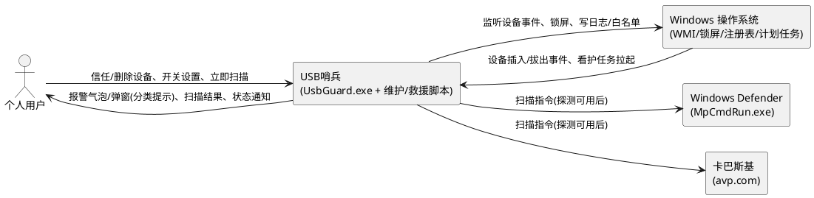
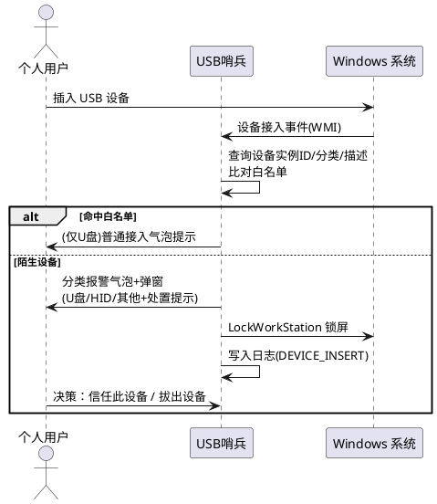
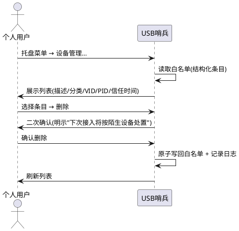
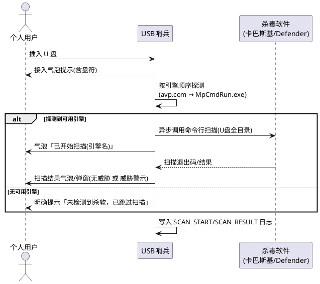
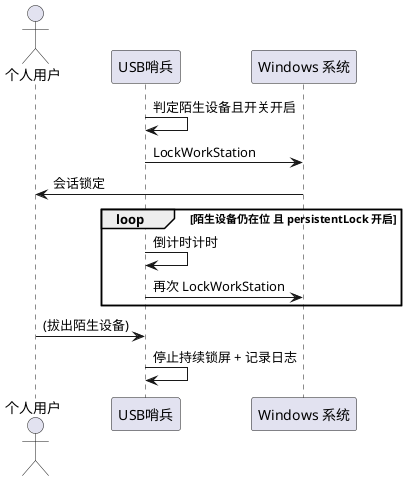
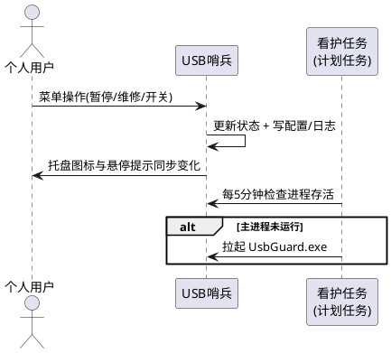
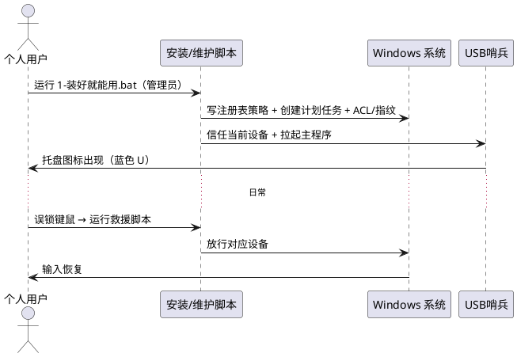
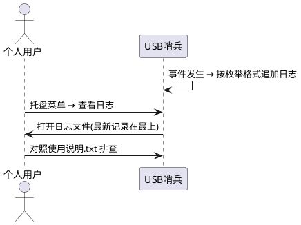
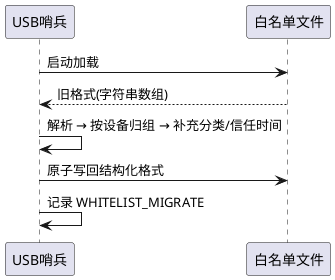

# USB哨兵完善迭代 需求规格（usb_sentinel_v2）

> **迭代定位**：个人自用的本机 USB 设备防护小工具，坚持「不联网、不收集数据、轻量单机」，不引入第三方依赖。
> **优先级图例**：P0 = 本轮必做核心增强；P1 = 重要改进；P2 = 可选顺手项；【保持】= 现有能力作为基线需求固化，本轮不做破坏性改动。
> **验收条件语法（EARS）**：`当 <触发/条件> 时 → 系统应当 <响应>`；`如果 <条件>，那么系统应当 <响应>`；`当 <状态> 持续期间 → 系统应当 <响应>`。

## 迭代范围与优先级总览

| 编号 | 能力模块 | 类型 | 优先级 |
|------|----------|------|--------|
| 5.1 | 陌生设备监控与分类报警（U盘/HID/其他区分提示） | 增强 | P0 |
| 5.2 | 白名单与设备管理窗口（列表查看、删除误信任设备） | 新增 | P0 |
| 5.3 | U盘接入与多杀软自动扫描（Defender + 卡巴斯基 + 无杀软明确提示） | 增强 | P0 |
| 5.4 | 锁屏响应与持续锁屏 | 保持 | P0 |
| 5.5 | 守卫运行控制与看护（托盘菜单、暂停/维修模式、开关） | 保持（小增强 P1） | P0/P1 |
| 5.6 | 系统级加固与救援恢复（安装/撤销/策略守护/救援脚本） | 保持（一致性增强 P1） | P0/P1 |
| 5.7 | 日志诊断与使用说明同步 | 增强 | P1 |
| 5.8 | 白名单结构化迁移与设备分组 | 支撑 5.2 | P0 |

# **1. 组件定位**

## **1.1 核心职责**
本组件负责监控本机 USB 设备接入、识别陌生设备并自动阻断威胁（分类报警、锁屏、拒绝装驱动、U盘扫描），实现无人值守的单机 USB 防线。

## **1.2 核心输入**
1. **USB 设备事件**：来源于 Windows WMI（Win32_DeviceChangeEvent），内容为设备插入/拔出信号。
2. **设备身份信息**：来源于 Windows 设备实例查询，内容为设备实例 ID（含 VID、PID、序列号/端口实例）、设备类、设备描述。
3. **用户操作指令**：来源于托盘右键菜单与设备管理窗口，内容为信任/删除设备、暂停守卫、维修模式、各类开关、立即扫描、查看日志等。
4. **配置文件**：来源于 `usb-guard-config.json`，内容为 lockOnUnknown、persistentLock、autoScanRemovable 等开关状态。
5. **计划任务触发信号**：来源于 Windows 任务计划程序（看护拉起、策略守护、状态提示）。
6. **命令行参数**：来源于快捷方式或手动执行，内容为 `--test-alert`、`--test-prompt`、`--sync-allow` 等测试与维护入口。

## **1.3 核心输出**
1. **报警呈现**：输出到桌面气泡与报警弹窗，内容含设备分类（U盘/HID/其他）、设备描述、处置建议。
2. **锁屏动作**：调用 Windows LockWorkStation，立即锁定当前会话。
3. **杀软扫描指令**：调用本机已装杀毒软件命令行（Windows Defender MpCmdRun.exe / 卡巴斯基 avp.com），对 U 盘执行离线扫描。
4. **白名单与配置写回**：更新 `usb-whitelist.json` 与 `usb-guard-config.json`。
5. **日志**：追加写入 `%LOCALAPPDATA%\USBGuard\usb-guard.log`，新记录在最上面。
6. **注册表策略变更**：由安装/撤销/策略守护脚本写入设备安装策略键与可移动磁盘执行限制（主程序不常驻改写）。

## **1.4 职责边界**
本组件**不负责**以下事项：
1. **不联网**：不上传设备信息、日志、白名单等任何数据，不在线检查病毒库；所有能力仅限本机。
2. **不承担病毒查杀本体**：只负责「发现 U 盘并调起本机已装杀软」，查杀能力与病毒库维护属于杀毒软件。
3. **不管理非 USB 接入面**：网络映射盘、内置磁盘、BitLocker 加密策略不在职责内。
4. **不提供多用户/远程管理**：仅本机托盘与窗口交互，无 Web 控制台、无账号体系。
5. **不常驻改写系统策略**：注册表 DeviceInstall 策略由安装脚本与 SYSTEM 策略守护任务负责，主程序仅在「同步系统USB锁定」维护入口被显式调用时参与。
6. **不做设备取证**：日志只记录身份与动作结果，不采集文件内容。

# **2. 领域术语**

**白名单**
: 已被用户明确信任、允许接入本机的 USB 设备清单，持久化于 `usb-whitelist.json`。目标形态为结构化条目列表（见 6.1），旧版为设备实例 ID 字符串数组，读取时自动迁移。

**设备实例 ID**
: Windows 为每个设备接口分配的唯一路径字符串（形如 `USB\VID_1234&PID_5678\8&XXXXXXXX&0&0001`），本组件以此作为陌生判定的精确依据。备注：一台物理设备可能对应多个接口实例 ID（如复合设备的 MI_00/MI_01）。

**陌生设备**
: 接入时其设备实例 ID 未命中白名单的 USB 设备。判定只依据设备身份，与设备当前是否可用无关。

**设备分类**
: 按用途划分的提示类别，分三类：**U盘**（可移动存储）、**HID**（键盘/鼠标等输入设备）、**其他**（网卡、摄像头、打印机、手机等）。备注：分类仅用于报警文案、扫描决策与日志，不改变「陌生即报警」的策略。

**持续锁屏**
: 当陌生设备仍在位时反复执行锁屏的强化策略；设备拔出后自动停止。

**暂停守卫**
: 托盘菜单触发的临时静默状态，持续 30 分钟，期间陌生设备接入不触发锁屏与报警弹窗，仅记录日志。

**维修模式**
: 交给维修人员前的临时全面放行状态，期间监控与阻断全部停用，恢复后立即重新生效。

**看护任务**
: Windows 计划任务「USB哨兵看护」，登录启动并每 5 分钟通过 watchdog.vbs 拉起未运行的主进程。

**策略守护**
: 以 SYSTEM 身份每 10 分钟运行的计划任务「USB哨兵策略守护」，把注册表策略校正回加固状态，防止意外改动或逐渐漂移。

**多杀软扫描**
: 本轮新增能力——按探测顺序在本机寻找可用的杀毒软件命令行（卡巴斯基 avp.com、Windows Defender MpCmdRun.exe），使用第一个可用者对 U 盘执行扫描。

**救援脚本**
: 误将键盘/鼠标锁定后用于恢复输入的专用脚本（`修复-放行此鼠标.bat`、`recover-input.bat/.ps1`、`recover-keyboard.bat/.ps1`、`allow-mouse.ps1`）。

**USB锁定（系统级加固）**
: 通过注册表 DenyUnspecified=1 + AllowDeviceIDs（实例级白名单 + 本机已装设备兜底）+ DenyDeviceClasses 实现的驱动安装拦截，叠加可移动磁盘 Deny_Execute=1（禁止从 U 盘执行程序）。

# **3. 角色与边界**

## **3.1 核心角色**
1. **个人用户（本机管理员）**：本工具唯一使用者；通过托盘菜单与设备管理窗口信任/删除设备、调整防护开关、查看白名单与日志；在插入新设备后做出信任决策；在误锁键鼠时执行救援脚本。

## **3.2 外部系统**
1. **Windows 操作系统**：提供 WMI 设备事件、设备实例查询、LockWorkStation、注册表、任务计划程序、气泡通知等能力。
2. **Windows Defender**：提供 MpCmdRun.exe 命令行扫描能力（本轮新增支持）。
3. **卡巴斯基**：提供 avp.com 命令行扫描能力（现有支持）。
4. **维护/救援脚本族**（`1-装好就能用.bat`、`安装.ps1`、`2-添加新设备.bat`、`3-撤销加固.bat`、各救援脚本）：负责安装期加固、临时解锁装驱动、撤销加固、误锁救援；与主程序共享白名单与配置状态。

## **3.3 交互上下文**

# **4. DFX约束**

## **4.1 性能**
1. 设备插入事件到用户可见提示（气泡或弹窗）的延迟必须 ≤ 3 秒。
2. 主进程常驻内存占用必须 ≤ 50 MB，空闲 CPU 占用必须 ≤ 1%。
3. 托盘菜单与设备管理窗口从点击到呈现必须 ≤ 1 秒。
4. 单次白名单匹配判定必须 ≤ 100 毫秒（条目数 ≤ 500 时）。
5. 杀软扫描必须异步执行，不得阻塞主进程的监控与锁屏流程。

## **4.2 可靠性**
1. 主进程意外退出后，必须在 ≤ 5 分钟内被看护任务自动拉起。
2. 日志或白名单文件写入失败不得导致主进程崩溃或防护失效。
3. 白名单文件损坏或解析失败时，必须进入**安全降级模式**：不触发锁屏、仅弹窗提示修复并记录日志（宁可漏报、不可误锁键鼠导致用户失去操作能力）。
4. 杀软扫描调用失败或超时不得影响监控主流程。
5. 同一设备的反复插拔事件必须去重合并，不得形成弹窗风暴。

## **4.3 安全性**
1. 全部数据仅存本机：白名单、配置、日志均位于本机路径，程序不得包含任何网络通信代码路径。
2. 程序目录 ACL 必须保持 Users 只读、仅日志可写；`integrity.json` 保存关键文件 SHA256 指纹。
3. 白名单与配置写回必须原子化（写临时文件后替换），防止写入中途断电导致文件损坏。
4. 日志内容仅限设备身份与动作结果，不得包含文件内容、剪贴板等用户敏感数据。
5. 删除白名单条目必须二次确认，防止误删导致防护面意外扩大。

## **4.4 可维护性**
1. 每条日志必须包含：时间戳、级别（INFO/WARN/ERROR）、事件类型枚举、设备摘要、动作与结果。
2. 事件类型必须使用固定枚举：`DEVICE_INSERT`、`DEVICE_TRUST`、`DEVICE_REMOVE`、`SCAN_START`、`SCAN_RESULT`、`LOCK_TRIGGER`、`WHITELIST_MIGRATE`、`GUARD_STATE` 等。
3. 日志超过 300KB 必须自动截断并保留最新记录（现有行为保持）。
4. `--test-alert` / `--test-prompt` 等自测入口必须保持可用。

## **4.5 兼容性**
1. 必须支持 Windows 10 / Windows 11，仅使用 .NET Framework 自带程序集（System.Management、System.Web.Script.Serialization、System.Drawing），不引入第三方依赖。
2. 旧版白名单（设备实例 ID 字符串数组）必须能被新版自动读取并迁移为结构化条目，迁移后不得造成已信任设备被误报。
3. `usb-guard-config.json` 缺失或字段缺失时必须采用安全默认值：lockOnUnknown=true、persistentLock=true、autoScanRemovable=true；未知字段必须忽略而非报错。
4. 新增配置字段（扫描引擎顺序等）必须向后兼容：旧配置文件无需手工修改即可被新版读取。

# **5. 核心能力**

## **5.1 陌生设备监控与分类报警【P0·增强】**

### **5.1.1 业务规则**
1. **白名单精确匹配规则**：设备接入时必须以设备实例 ID 与白名单精确比对；命中白名单的设备接入不得触发报警与锁屏。
   a. 验收条件：当已信任设备的实例 ID 与白名单条目一致时 → 系统应当静默放行，仅对 U 盘给出普通接入气泡提示。
2. **陌生设备报警规则**：未命中白名单的设备接入必须触发「气泡提示 + 报警弹窗 + 锁屏（受开关控制）+ 日志」。
   a. 验收条件：当陌生设备接入且 lockOnUnknown 开启时 → 系统应当在 3 秒内弹出报警弹窗并锁定会话。
3. **分类提示规则（新增）**：报警信息必须标明设备分类与设备描述，并给出分类对应的处置提示。
   a. 验收条件：当陌生 U 盘（可移动存储）接入时 → 报警文案必须包含「U盘」字样及「请勿拷贝/打开其中文件」提示。
   b. 验收条件：当陌生 HID（键鼠类）设备接入时 → 报警文案必须包含「键盘/鼠标类设备」及「警惕 BadUSB 输入注入」提示。
   c. 验收条件：当陌生设备属于其他类（网卡/摄像头等）时 → 报警文案必须包含「其他 USB 设备」及设备描述字符串。
4. **暂停守卫规则（保持）**：暂停期间陌生设备接入不弹窗不锁屏，30 分钟后自动恢复拦截。
   a. 验收条件：当用户选择暂停守卫后 30 分钟内接入陌生设备时 → 系统应当仅记录日志，不弹窗不锁屏。
   b. 验收条件：当暂停满 30 分钟后接入陌生设备时 → 系统应当恢复完整报警与锁屏。
5. **维修模式规则（保持）**：维修模式期间全面停用监控，恢复后立即生效。
   a. 验收条件：当维修模式开启期间接入任意 USB 设备时 → 系统应当不报警不锁屏，仅记录日志。
6. **事件去重规则（增强）**：同一设备的接入事件必须按设备实例 ID 去重。
   a. 验收条件：当同一设备在 10 秒内多次触发接入事件时 → 系统应当只呈现一次报警，不重复弹窗刷屏。
7. **禁止项**：禁止在未命中白名单且用户未显式确认的情况下自动信任任何设备（`--sync-allow` 维护入口除外）。
   a. 验收条件：当陌生设备接入且用户未点击「信任此设备」时 → 系统应当不将该设备写入白名单。

### **5.1.2 交互流程**

### **5.1.3 异常场景**
1. **设备身份读取失败**
   a. 触发条件：设备实例查询超时或设备未上报身份信息。
   b. 系统行为：按陌生设备处理，日志记录「身份信息缺失」。
   c. 用户感知：报警文案标明「未知设备（身份读取失败）」。
2. **白名单文件损坏**
   a. 触发条件：JSON 解析失败或文件意外损坏。
   b. 系统行为：进入安全降级模式——不锁屏、保留现场文件、记录 ERROR 日志、持续弹窗提示。
   c. 用户感知：「白名单异常，请运行修复或重新安装」明确提示，不发生误锁键鼠。
3. **事件风暴**
   a. 触发条件：同一设备 10 秒内多次触发接入事件（接触不良/反复插拔）。
   b. 系统行为：按实例 ID 合并去重，仅保留一次报警。
   c. 用户感知：无重复弹窗。

## **5.2 白名单与设备管理窗口【P0·新增】**

### **5.2.1 业务规则**
1. **白名单列表查看规则（新增）**：必须提供设备管理窗口，展示全部白名单条目：设备描述、分类、VID/PID、实例 ID 摘要、信任时间。
   a. 验收条件：当用户从托盘菜单打开「设备管理…」时 → 系统应当在 1 秒内呈现完整白名单列表。
2. **删除单个条目规则（新增）**：必须支持删除单个白名单条目，删除前必须二次确认并明示后果。
   a. 验收条件：当用户删除某条目并确认时 → 系统应当原子化写回白名单、记录 `DEVICE_REMOVE` 日志。
   b. 验收条件：当被删除设备下次接入时 → 系统应当按陌生设备触发完整报警与锁屏。
3. **信任当前设备规则（保持）**：报警弹窗与托盘菜单的「信任此设备」必须写入实例级条目并自动分组关联接口实例。
   a. 验收条件：当用户在报警弹窗点击「信任此设备」时 → 系统应当把该设备的全部接口实例 ID 归入同一白名单条目。
4. **入口规则（新增）**：托盘菜单必须新增「设备管理…」项；报警弹窗必须提供「管理白名单」按钮。
5. **空态引导规则（新增）**：列表为空时必须显示引导文案。
   a. 验收条件：当白名单为空时 → 窗口应当显示「接入设备后在报警弹窗中点击信任即可加入名单」。
6. **批量清理规则（P2·可选）**：可提供「清空全部」入口，但必须要求输入确认文字而非单击。
7. **禁止项**：删除操作禁止免确认直接生效；设备管理窗口禁止提供任何联网同步能力。
   a. 验收条件：当用户仅单击删除时 → 系统应当不删除条目，必须等待二次确认。

### **5.2.2 交互流程**

### **5.2.3 异常场景**
1. **白名单写入失败**
   a. 触发条件：文件被占用或权限不足。
   b. 系统行为：保留原文件不覆盖，记录 ERROR 日志。
   c. 用户感知：「保存失败，名单未变更」提示。
2. **旧格式迁移中断**
   a. 触发条件：迁移写回时程序退出或断电。
   b. 系统行为：下次启动检测到旧格式仍未迁移时重新执行迁移（迁移操作幂等）。
   c. 用户感知：无感知，白名单数据不丢失。

## **5.3 U盘接入与多杀软自动扫描【P0·增强】**

### **5.3.1 业务规则**
1. **U盘接入提示规则（保持）**：可移动存储接入时必须给出接入气泡提示（含盘符）。
   a. 验收条件：当 U 盘接入并分配盘符时 → 系统应当弹出含盘符的接入提示。
2. **多杀软探测规则（新增）**：自动扫描触发时必须按配置的引擎顺序探测可用杀软命令行，默认顺序为「卡巴斯基 avp.com → Windows Defender MpCmdRun.exe」，使用第一个探测成功者。
   a. 验收条件：当本机卡巴斯基 avp.com 可用时 → 系统应当调用卡巴斯基执行扫描。
   b. 验收条件：当 avp.com 不可用且 Defender 的 MpCmdRun.exe 可用时 → 系统应当调用 Defender 扫描。
   c. 验收条件：当用户通过配置指定引擎顺序时 → 系统应当按指定顺序探测。
3. **无杀软明确提示规则（新增）**：探测不到任何可用杀软时不得静默跳过。
   a. 验收条件：当无任何杀软可用且陌生 U 盘接入时 → 系统应当在提示中明确说明「未检测到可用杀毒软件，已跳过自动扫描，建议启用 Windows Defender 或安装杀软」，并记录 WARN 日志。
   b. 验收条件：当同一 U 盘持续在位时 → 该提示对同一设备只出现一次，不重复轰炸。
4. **扫描执行规则（增强）**：扫描必须异步执行，扫描目标为 U 盘全部目录；扫描启动与结束都必须有用户可见反馈。
   a. 验收条件：当扫描启动时 → 系统应当气泡显示「已开始扫描（引擎名）」。
   b. 验收条件：当扫描完成且未发现威胁时 → 系统应当气泡提示「扫描完成，未发现威胁」并记录 `SCAN_RESULT` 日志。
   c. 验收条件：当扫描发现威胁时 → 系统应当弹出警示弹窗（含引擎与威胁摘要）并记录 ERROR 日志。
5. **手动扫描规则（保持·沿 用多杀软探测）**：托盘「立即扫描」必须对当前在位 U 盘执行一次扫描，不受 autoScanRemovable 开关限制。
   a. 验收条件：当自动扫描关闭且用户点击「立即扫描」时 → 系统应当仍能按多杀软探测规则完成一次扫描。
6. **开关规则（保持）**：autoScanRemovable 关闭时插入 U 盘不自动扫描，仅保留接入提示。
   a. 验收条件：当自动扫描关闭且 U 盘接入时 → 系统应当只给接入提示，不启动扫描进程。
7. **禁止项**：扫描调用禁止产生任何联网行为；禁止以扫描为由阻断或延迟锁屏报警。
   a. 验收条件：当扫描进行中又发生陌生设备报警时 → 系统应当立即执行锁屏，不等待扫描结果。

### **5.3.2 交互流程**

### **5.3.3 异常场景**
1. **扫描引擎返回异常**
   a. 触发条件：杀软命令行返回非预期退出码或异常输出。
   b. 系统行为：记录 WARN 日志，不重试其他引擎。
   c. 用户感知：「扫描引擎返回异常，建议手动查杀」提示。
2. **扫描超时**
   a. 触发条件：扫描进程运行超过 10 分钟。
   b. 系统行为：终止扫描进程，记录日志。
   c. 用户感知：「扫描超时已中止」提示。
3. **扫描期间 U 盘被拔出**
   a. 触发条件：扫描进行中目标设备移除。
   b. 系统行为：终止扫描进程，记录「设备已移除，扫描中止」。
   c. 用户感知：简短气泡告知扫描中止。
4. **扫描与报警并发**
   a. 触发条件：扫描运行期间发生陌生设备报警。
   b. 系统行为：锁屏立即执行，扫描进程继续在后台运行。
   c. 用户感知：锁屏不受扫描影响。

## **5.4 锁屏响应与持续锁屏【保持】**

### **5.4.1 业务规则**
1. **立即锁屏规则（保持）**：陌生设备触发报警且 lockOnUnknown 开启时必须立即调用 LockWorkStation。
   a. 验收条件：当陌生设备接入且自动锁屏开启时 → 系统应当立即锁定会话。
2. **持续锁屏规则（保持）**：persistentLock 开启且陌生设备仍在位时必须按倒计时周期重复锁屏。
   a. 验收条件：当陌生设备持续在位且持续锁屏开启时 → 系统应当按周期反复锁屏，直至设备拔出。
   b. 验收条件：当陌生设备拔出时 → 系统应当停止持续锁屏并记录日志。
3. **自动锁屏关闭规则（保持）**：lockOnUnknown 关闭时仅气泡+弹窗+日志，不锁屏。
   a. 验收条件：当 lockOnUnknown 关闭且陌生设备接入时 → 系统应当报警但不锁屏。
4. **禁止项**：禁止对白名单命中设备、暂停守卫期间、维修模式期间执行任何锁屏。
   a. 验收条件：当设备命中白名单时 → 系统应当不触发任何锁屏动作。

### **5.4.2 交互流程**

### **5.4.3 异常场景**
1. **锁屏调用失败**
   a. 触发条件：LockWorkStation 调用返回失败。
   b. 系统行为：重试一次，仍失败则记录 ERROR 日志，弹窗保持（弹窗本身仍占据桌面警示）。
   c. 用户感知：至少保留报警弹窗警示。
2. **倒计时期间设备拔出**
   a. 触发条件：下次锁屏倒计时未到时设备被拔出。
   b. 系统行为：取消本次倒计时，停止持续锁屏。
   c. 用户感知：不再被重复锁屏。

## **5.5 守卫运行控制与看护【保持·小增强P1】**

### **5.5.1 业务规则**
1. **托盘常驻规则（保持）**：主进程必须以托盘图标常驻（蓝色 U），报警状态图标变红。
   a. 验收条件：当陌生设备报警发生时 → 托盘图标应当变为红色直至状态解除。
2. **托盘菜单规则（保持+新增入口）**：右键菜单必须包含：信任当前设备 / 暂停守卫 30 分钟 / 维修模式 / 自动锁屏开关 / 持续锁屏开关 / U盘自动扫描开关 / 立即扫描 / 设备管理…（新增） / 同步系统USB锁定 / 查看日志 / 开机自启 / 退出。
   a. 验收条件：当用户打开托盘右键菜单时 → 上述全部菜单项必须可见且可用。
3. **状态悬停提示规则（P1·新增）**：托盘图标悬停必须显示当前防护状态。
   a. 验收条件：当用户悬停托盘图标时 → 提示文案必须标明当前状态之一：防护中 / 暂停守卫（剩余时间）/ 维修模式 / 白名单异常。
4. **开关持久化规则（保持）**：lockOnUnknown、persistentLock、autoScanRemovable 三个开关必须写入配置文件，重启后保持。
   a. 验收条件：当用户切换任一开关并重启主进程时 → 开关状态必须与切换后一致。
5. **看护规则（保持）**：看护任务必须每 5 分钟检查主进程，未运行则拉起。
   a. 验收条件：当主进程被手动结束时 → 系统应当在 ≤ 5 分钟内自动恢复运行。
6. **开机自启规则（保持）**：必须提供开机自启开关，默认由安装脚本开启。
7. **状态提示规则（保持）**：状态提示任务每 5 分钟检查防护状态，异常时弹系统通知。
8. **禁止项**：暂停守卫与维修模式禁止永久生效（必须自动恢复或有明确时长）。
   a. 验收条件：当暂停守卫满 30 分钟或维修模式被手动关闭时 → 系统应当自动恢复完整防护并记录 `GUARD_STATE` 日志。

### **5.5.2 交互流程**

### **5.5.3 异常场景**
1. **配置文件损坏**
   a. 触发条件：配置 JSON 解析失败。
   b. 系统行为：按安全默认值（见 4.5）运行，重建配置文件并记录 WARN 日志。
   c. 用户感知：无中断，防护照常运行。
2. **看护拉起失败**
   a. 触发条件：看护任务连续 3 次拉起失败。
   b. 系统行为：状态提示任务弹出「哨兵未在运行」通知。
   c. 用户感知：明确的防护失效告警通知。
3. **托盘图标消失（explorer 重启）**
   a. 触发条件：资源管理器重启导致托盘图标丢失。
   b. 系统行为：主进程保持运行并在 explorer 恢复后重建图标。
   c. 用户感知：图标自动恢复。

## **5.6 系统级加固与救援恢复【保持·一致性增强P1】**

### **5.6.1 业务规则**
1. **安装加固规则（保持）**：`1-装好就能用.bat`（调用 `安装.ps1`，需管理员）必须完成：注册表 DenyUnspecified=1 + AllowDeviceIDs（实例级白名单 + 本机全部已装设备兜底，避免误伤 Tailscale 虚拟网卡等既有设备）+ DenyDeviceClasses（USB 存储/HID 类拒绝作纵深）+ 可移动磁盘 Deny_Execute=1 + ACL 锁定目录 + integrity.json 指纹 + 四个计划任务（看护/策略守护/状态提示/实时进程）+ 信任当前插着的设备 + 开机自启。
   a. 验收条件：当安装完成后 → 未列入 AllowDeviceIDs 的新 USB 存储与 HID 设备应当被 Windows 拒绝安装驱动。
   b. 验收条件：当本机原有设备（含 Tailscale 虚拟网卡）工作时 → 安装后不得出现断网或键鼠失灵。
2. **清单同源规则（P1·新增）**：安装脚本生成的系统级 AllowDeviceIDs 必须与 `usb-whitelist.json` 同源生成，禁止两处清单独立演化导致漂移。
   a. 验收条件：当用户通过设备管理窗口信任/删除设备后 → 系统级 AllowDeviceIDs 应当在下次「同步系统USB锁定」或策略校正时与白名单保持一致。
3. **策略守护规则（保持）**：策略守护任务（SYSTEM，每 10 分钟）必须把策略键校正回加固状态。
   a. 验收条件：当策略键被意外改动时 → 系统应当在 ≤ 10 分钟内自动校正并记录日志。
4. **添加新设备流程规则（保持）**：`2-添加新设备.bat` 必须完成：临时解锁 → 用户插设备装驱动 → 主程序信任 → 自动恢复锁定。
5. **撤销加固规则（保持）**：`3-撤销加固.bat` 必须清理策略限制（是否保留计划任务按脚本现行行为）。
6. **救援规则（保持）**：误锁键鼠时必须可通过救援脚本（`修复-放行此鼠标.bat` / `recover-input.*` / `recover-keyboard.*` / `allow-mouse.ps1`）放行恢复输入。
   a. 验收条件：当键盘或鼠标被误锁且用户运行对应救援脚本时 → 输入功能应当恢复。
7. **禁止项**：系统级策略禁止被主程序在无用户显式操作时改动。
   a. 验收条件：当无「同步系统USB锁定」显式操作时 → 主程序应当不写注册表策略键。

### **5.6.2 交互流程**

### **5.6.3 异常场景**
1. **无管理员权限安装**
   a. 触发条件：用户拒绝 UAC 或以普通权限运行安装脚本。
   b. 系统行为：脚本明确报错退出，不写半截策略。
   c. 用户感知：「需要管理员权限，请重试并选择『是』」。
2. **策略漂移**
   a. 触发条件：策略键被其他软件或误操作改动。
   b. 系统行为：策略守护任务自动校正。
   c. 用户感知：无感知，仅日志可见校正记录。
3. **救援脚本失效**
   a. 触发条件：设备实例 ID 与救援脚本内置目标不符。
   b. 系统行为：脚本输出明确的「目标设备未找到」信息，提示改用 2-添加新设备.bat 流程。
   c. 用户感知：明确的下一步指引，不盲目改策略。

## **5.7 日志诊断与使用说明同步【P1·增强】**

### **5.7.1 业务规则**
1. **结构化日志规则（增强）**：日志每条记录必须符合 4.4 的格式规范（时间戳、级别、事件类型枚举、设备摘要、结果），新记录在最上面。
   a. 验收条件：当任意事件（接入/信任/删除/扫描/锁屏/状态变化）发生时 → 系统应当按规范格式追加一条日志。
2. **日志截断规则（保持）**：日志超过 300KB 必须自动截断，保留最新记录。
3. **日志查看规则（保持）**：托盘「查看日志」必须能直接打开日志文件。
4. **使用说明同步规则（增强）**：`使用说明.txt` 必须与实际功能完全一致，本轮必须补充：多杀软扫描说明（含无杀软提示）、设备管理窗口用法、扫描引擎顺序配置、救援脚本清单。
   a. 验收条件：当本轮迭代完成时 → 使用说明.txt 中描述的每个功能应当与程序实际行为一致，无已废弃描述、无缺失描述，并在文档头部标注版本与更新日期。
   b. 验收条件：当新增配置项（扫描引擎顺序）存在时 → 使用说明应当包含其修改方法与默认值。
5. **禁止项**：日志禁止记录文件内容等用户敏感数据；说明文档禁止描述任何不存在的功能。

### **5.7.2 交互流程**

### **5.7.3 异常场景**
1. **日志写入失败**
   a. 触发条件：日志文件被占用或磁盘异常。
   b. 系统行为：静默跳过本次写入，下次事件重试，不影响防护。
   c. 用户感知：无感知。
2. **日志目录缺失**
   a. 触发条件：`%LOCALAPPDATA%\USBGuard` 目录不存在。
   b. 系统行为：自动重建目录。
   c. 用户感知：无感知。

## **5.8 白名单结构化迁移与设备分组【P0·支撑5.2】**

### **5.8.1 业务规则**
1. **迁移规则（新增）**：启动时检测到旧版白名单（设备实例 ID 字符串数组）必须自动迁移为结构化条目（见 6.1），迁移必须幂等。
   a. 验收条件：当旧格式白名单被加载时 → 系统应当自动完成迁移并将同设备多接口实例归组为单一条目，记录 `WHITELIST_MIGRATE` 日志。
   b. 验收条件：当迁移后设备再次接入时 → 系统应当仍判定为已信任，不误报。
2. **同设备归组规则（新增）**：信任设备时必须把该物理设备的全部接口实例 ID（如 MI_00/MI_01）归入同一白名单条目。
   a. 验收条件：当复合设备（多接口）被信任时 → 设备管理窗口应当只显示一个条目。
3. **禁止项**：迁移禁止删除或合并丢失任何实例 ID；禁止在迁移失败时清空白名单。
   a. 验收条件：当迁移解析出现异常实例 ID 时 → 系统应当原样保留该条目并记录 WARN 日志。

### **5.8.2 交互流程**

### **5.8.3 异常场景**
1. **迁移中断**
   a. 触发条件：迁移写回时程序退出。
   b. 系统行为：下次启动重新执行迁移（幂等，旧文件先备份）。
   c. 用户感知：无感知。
2. **异常实例 ID**
   a. 触发条件：白名单中存在无法解析的实例 ID 字符串。
   b. 系统行为：原样保留，记录 WARN。
   c. 用户感知：设备管理窗口中显示为「未识别条目」。

# **6. 数据约束**

## **6.1 白名单条目（usb-whitelist.json，目标结构化形态）**
1. **deviceIds**：必填，字符串数组；同一物理设备的全部设备实例 ID（1~N 个）；条目间不得出现重复实例 ID。
2. **description**：可选，设备描述字符串（来自系统设备名，展示用），缺省显示「未知设备」。
3. **category**：可选，枚举 `storage` / `hid` / `other`，新增字段；缺省按 `other` 处理。
4. **trustedAt**：可选，信任时间（本地时间，ISO 8601 格式），新增字段；缺省显示「—」。
5. **唯一性**：同一 deviceIds 组合不得重复出现在多个条目中；同一实例 ID 不得同时属于两个条目。
6. **兼容性**：允许读取旧格式（实例 ID 字符串数组），读取后按 5.8 迁移规则处理，迁移前旧文件先备份。

## **6.2 配置（usb-guard-config.json）**
1. **lockOnUnknown**：必填布尔，陌生设备自动锁屏开关，缺省 true。
2. **persistentLock**：必填布尔，持续锁屏开关，缺省 true。
3. **autoScanRemovable**：必填布尔，U盘自动扫描开关，缺省 true。
4. **scanEngineOrder**（P1·新增）：可选枚举数组，取值 `kaspersky` / `defender` 的排列（如 ["kaspersky","defender"]），缺省 ["kaspersky","defender"]（卡巴优先，尊重已付费安装的专业杀软）。
5. **兼容性**：未知字段必须忽略；缺失字段采用上表缺省值。

## **6.3 日志记录（usb-guard.log）**
1. **时间戳**：必填，本地时间，精确到秒。
2. **级别**：必填，枚举 INFO / WARN / ERROR。
3. **事件类型**：必填，固定枚举（见 4.4 第 2 条）。
4. **设备摘要**：条件必填（设备类事件），内容为分类 + 实例 ID（或 VID/PID）。
5. **动作与结果**：必填，一句话描述动作与结果。
6. **容量约束**：单文件 ≤ 300KB，超限截断保留最新。

## **6.4 守卫状态文件（last_guard_state.txt / integrity.json，保持）**
1. **last_guard_state.txt**：可选，主进程最近一次防护状态快照，供状态提示任务判断防护是否失效。
2. **integrity.json**：必填（安装后），关键文件 SHA256 指纹清单，用于完整性核对。